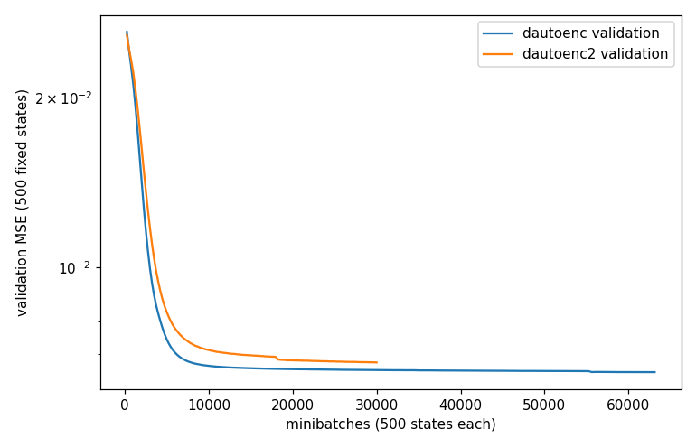
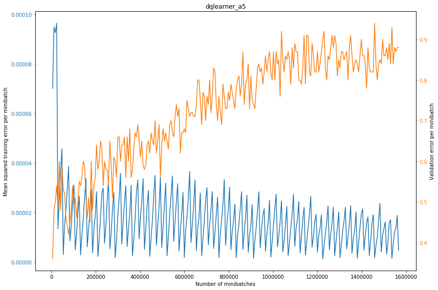
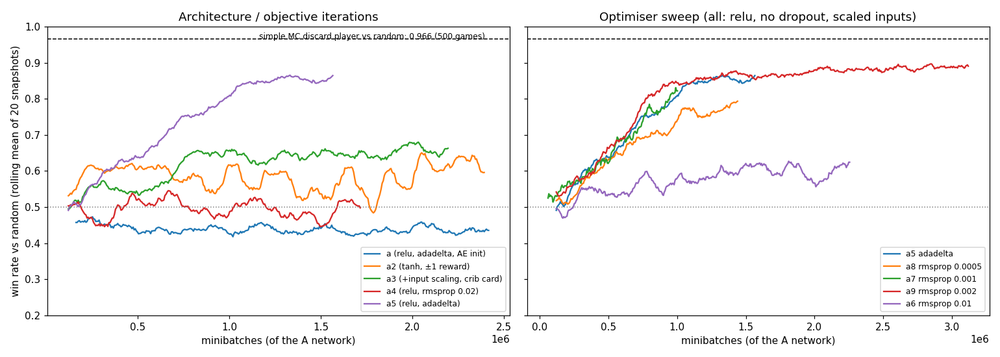
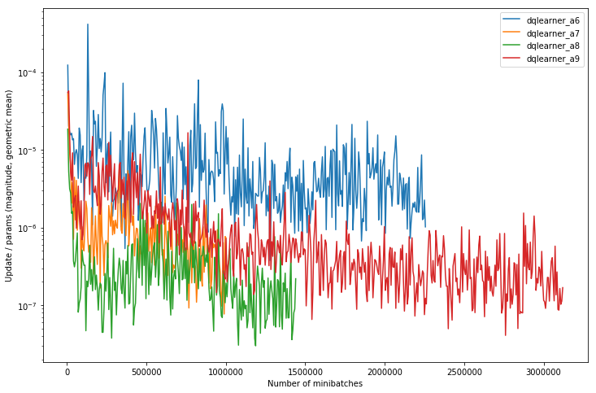
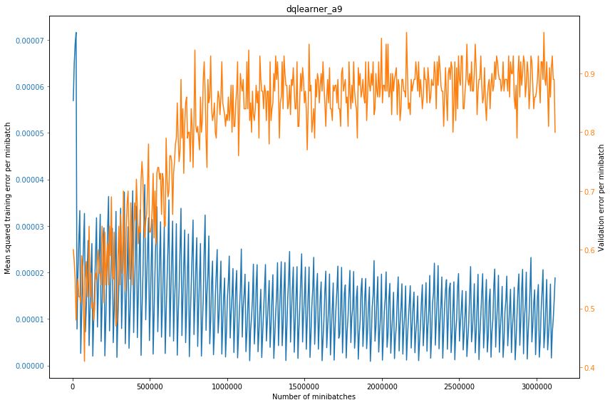
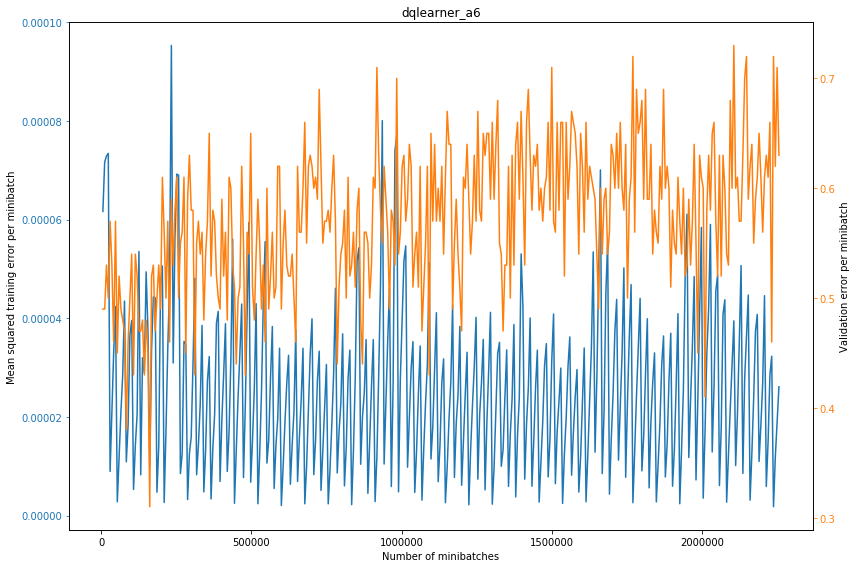
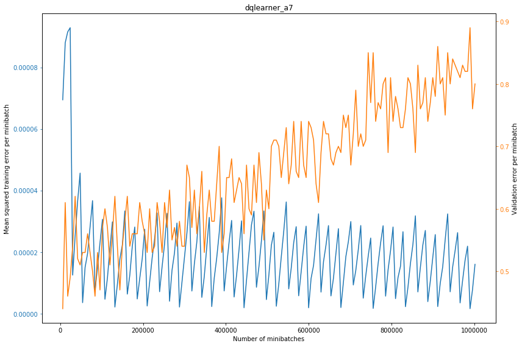
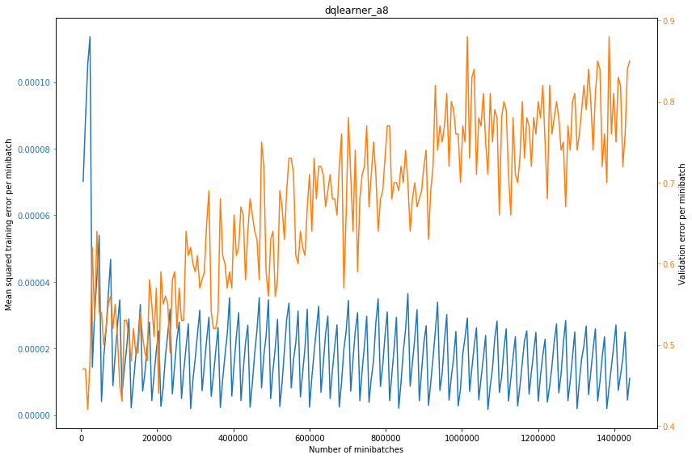

# Lab book: learning to discard in cribbage with double Q-learning (Dec 2016 – Feb 2017)

*Reconstructed in October 2026 from `notes.org`, `models/README.rst`, the 2017 versions of
`expt.py`, `dqlearning.py`, `netbuilder.py`, `neural.py`, `notes.py` and `discard_models.ipynb`
(all as of commit `2ff3e46`, 2017-02-18), the git history, and the model directories that are
still on disk in `models/` (each has a `metadata.json` with every training snapshot). Statements
marked **(inferred)** are my reading of the code or data, not something recorded at the time.*

---

## 0. Summary

**The question.** Can a neural network learn to play the *discard* decision in cribbage (which
two of the six dealt cards to throw into the crib) from nothing but the result of whole games,
using double Q-learning (Mnih et al. 2015; van Hasselt 2010, the two references in the README)?
And how good does it get compared with a hand-written Monte Carlo baseline?

**How far did it get?**

| Player (all play pegging randomly, so only the discard policy differs) | Win rate vs. random player |
|---|---|
| Random discard | 0.50 (487/1000, random vs. random) |
| Best double-Q network, `dqlearner_a9` (500 games) | **0.894** |
| "Simple" player: Monte Carlo expected-score discard (500 games) | **0.966** |

Head to head, simple-discard beat the best network **343 – 157** (the network won 31.4 %).

1. **The approach works, partially.** Six of the nine configurations finished clearly above 0.6
   (last-20-snapshot mean), and the best three (adadelta; RMSprop with learning rates 0.001 and
   0.002) reach a validation win rate of roughly 0.81–0.89 against a random player after 1–3 M
   minibatches of the A network (§3, figure 1).
2. **It does not reach the hand-written baseline.** The best network plateaus at about 0.88 and
   stays flat from about 1.5 M to 3.1 M minibatches (`a9`), so more of the same training probably
   would not close the gap to 0.966 **(inferred; no run was continued with a change of regime)**.
3. **Learning rate and optimiser were the decisive knob.** With everything else fixed, RMSprop at
   0.01 learned little (≈0.6), while 0.001–0.002 and adadelta reached the high 0.8s; 0.0005 was
   slower but still climbing when stopped (§2.10). The earlier changes (activation, dropout,
   autoencoder pre-training, reward coding, input scaling) were changed several at a time, so
   their individual effects are **not** separable (§4.2).
4. **What was never answered:** whether the network's Q-values mean anything, whether A and B
   agree with each other, whether the remaining gap is due to representation, reward sparsity or
   the opponent being random, and how much of any difference is run-to-run noise (every
   configuration was run once, with no seed).

The rest of this document tells the story in order, then collects the evidence and the caveats.

---

## 1. Background and setup

### 1.1 Project timeline before the experiments (Dec 2016 – early Jan 2017)

| Date | Work (from git history) |
|---|---|
| 2016-12-23 | Initial commit; `score_hand` in Python; a C implementation (`cribbage_score.c`) wrapped in Cython. README claims it is 100× faster than Python. |
| 2016-12-24/25 | A `Game`/`Round` engine with dealing, discarding, pegging ("play"), and the show; split into a package. |
| 2016-12-26 | `simpleplayer.py`: first "simple AI", plus profiling. |
| 2017-01-06 | `neural.py`: notes and then code on how to represent game states as vectors. |
| 2017-01-08–11 | A `NeuralRecordingCribbagePlayer` wrapper that records `(s, a, r, s')` tuples as a player plays; `Game` plays to 121 points. |
| 2017-01-11–13 | `netbuilder.py`: the declarative network/`ModelStore` layer (§1.4). |
| 2017-01-12 → | `expt.py`: the experiments themselves. |

### 1.2 Baselines from `notes.py` (Dec 2016 – Jan 2017)

`notes.py` was a scratch file of `compare_players` calls with the results pasted in as comments.
Players are "random" (random discards and plays) or "simple" (`SimpleCribbagePlayer`: Monte
Carlo estimate of the value of each discard, and of each pegging play, with
`num_discard_samples=20` by default). Counts are wins of the first player and then the second.
The `estimate_discard` / `estimate_playcard` flags switch each of the two skills on or off.

| Match (500 games unless stated) | Result | Win rate of the second player |
|---|---|---|
| random vs. random (1000 games) | 487 – 513 | – (sanity check that seat/dealer order is fair) |
| random vs. simple (both skills) | 16 – 484 | 0.968 |
| random vs. simple, **discard only** | 12 – 488 | **0.976** (in the notes: χ² = 0.5879, p = 0.443 for 16 vs. 12) |
| random vs. simple, **pegging only** | 161 – 339 | 0.678 |
| simple (both) vs. simple (discard only) | 326 – 174; later 298 – 202 and 325 – 175 after code optimisation | ≈ 0.35–0.40 for discard-only |
| simple (pegging only) vs. simple (discard only) | 48 – 452 | 0.904 for discard-only |

Reading: **the discard decision is worth far more than the pegging decision** against a random
opponent (97–98 % vs. 68 %), and adding pegging search on top of good discards makes no
detectable difference against a random opponent (16 vs. 12 losses). This is why the learning
experiments only try to learn `discard()`: the learned player plays pegging at random, and the
fair comparison is "simple, discard only", which `discard_models.ipynb` measures as **0.966**
(483/500) against random.

**How many Monte Carlo samples does the simple discard need?** (`notes.py`, 2017-01-10; 200 games
each, default player with 20 samples vs. a player with *N* samples):

| N | 5 | 10 | 20 | 50 | 100 | 200 | 500 | 1000 |
|---|---|---|---|---|---|---|---|---|
| wins of default (20) – wins of N | 116 – 84 | 99 – 101 | 96 – 104 | 107 – 93 | 104 – 96 | 102 – 98 | 98 – 102 | 102 – 98 |

Only N = 5 is distinguishable from 20 (116 – 84 is z ≈ 2.3), and even that is marginal; from 10
upwards the player is indistinguishable at this sample size (standard error ≈ 3.5 percentage
points). On 2017-01-11 the default was set to 20. This matters later: the "simple" baseline is
already near the plateau of what MC-estimated discarding can do, so 0.966 is a sensible target.

### 1.3 Problem formulation

* **Environment.** A full game of cribbage to 121 against a `RandomCribbagePlayer`. The learner
  controls only `discard()`; its pegging plays are uniformly random among legal moves
  (`QLearningPlayer.play_card` ignores its model; there is a `TODO: integrate play_card_model`).
* **Two-step action.** A discard is a *sequence of two actions* (commit `cf65c7b`, 2017-01-13).
  The first action throws one card; the state is re-encoded with that card marked, and the
  second action throws the other. The action is the card value 0–51, so the network has 52
  outputs and the best action is the argmax over the cards actually in hand (`choose_discard_actions`
  masks everything else). The order of the two discards is randomised when recording.
* **State vector** (`neural.discard_state_repr`):

  | Units | Meaning |
  |---|---|
  | 1 | am I the dealer? |
  | 52 | cards still in my hand (multi-hot; 6 on at the first step, 5 at the second) |
  | 52 (added 2017-01-22) | the card already thrown to the crib, one-hot (empty at the first step) |
  | 121 | my score, one-hot |
  | 121 | opponent's score, one-hot |

  That is **295** inputs before 2017-01-22 and **347** after.
* **Reward.** 0 at every discard decision; at the end of a game the final transition gets the
  reward and next state `None` (assigned a Q value of 0). The first runs used reward 1 for a win
  and 0 for a loss; from `a2` onward it is **+1 for a win and −1 for a loss** (commit `7caa368`,
  "with_punishment"). Discount γ = 0.99, per decision (two decisions per round).
  The consequence is a very sparse and delayed signal: every learning target but the last in a
  game is a bootstrapped estimate.
* **Validation statistic** (`dqlearner_vs_random`): the win fraction of the current model A, with
  ε = 0.05, against a random player over **100 games**. Standard error is about 0.05 at a win
  rate of 0.5 and 0.03 at 0.9. Models A and B are both validated by playing **model A**
  (`functools.partial(dqlearner_vs_random, dqlearner_a)`; the function ignores its second
  argument), so the numbers stored with B's snapshots are measurements of A, not of B.
  The notes list "validation: check both A and B models" as an open to-do.

### 1.4 Code that was written to run the experiments

* **`neural.py`**: state/action encoders and `NeuralRecordingCribbagePlayer`, which wraps any
  player and, as a game proceeds, builds a list of `(s, a, r, s')` tuples for discards (and
  separately for pegging, which was never used). `record_player1_states` /
  `record_both_player_states` play a whole game and return the tuples.
* **`netbuilder.py`** (Jan 11–13, extended through Feb 5): a declarative layer over Lasagne/Theano.
  `Model(store, name)` describes `input / hidden / output / objective / update / update_args /
  input_scaler / training / validation / minibatch_size / max_num_minibatches`; the
  architecture and update rule are saved to `metadata.json`, a snapshot of the weights
  (`NNNNNNNNNN.npz`) and its metadata (train error, validation statistic, and from 2017-01-24 the
  ratio of update magnitude to parameter magnitude) are written every `validation_interval`
  minibatches, and a model restarted from a snapshot checks that the code still describes the same
  architecture. `build(model)` is the training loop. `make_input_scaler` (added 2017-01-22,
  moved here 2017-02-05) standardises inputs with a mean and standard deviation estimated from
  100 000 random-play states (`models/discard_scaling.npz`).
* **`dqlearning.py`** (2017-02-02, made stateful 2017-02-05): the `DQLearner` class (§1.5).
* **`expt.py`**: recipes for the autoencoders and for `make_dqlearner` / `learn_discard`.
* Speed: on 2017-01-22 a profiling round led to Cython versions of `card_worth`, `cards_worth`,
  `is_legal_play`, `get_legal_play_idxs`, and on 2017-01-25 `score_play`; a profile of one
  Q-learning loop (312 minibatches plus 5 000 sampled states) afterwards took 2.8 s, of which
  1.5 s was inside the Theano training function and 0.6 s in `Round.play`.

### 1.5 The learning algorithm (`DQLearner`, double Q-learning with replay)

One loop (`train_step`):

1. Pick one of the two networks at random to be **updated** (the other is the **scorer**).
2. Using the *updated* network with ε-greedy discards, play games against a random player and add
   5 000 new `(s, a, r, s')` discard tuples to the replay memory. ε is annealed linearly from 1.0
   to 0.1 over the first 1 000 000 minibatches of the updated network, and stays at 0.1 after.
3. Draw 312 × 32 tuples uniformly **with replacement** from the replay memory.
4. For each tuple with a successor state, the target is
   `r + γ · Q_scorer(s', argmax_a Q_updated(s', a))`; the other 51 outputs of the training target
   are set to the network's own current predictions, so only the chosen action receives gradient.
   Terminal tuples have target `r`. (No α as in van Hasselt's poster; SGD does the interpolation.)
5. Train the updated network for one epoch (312 minibatches of 32) on these targets.

Replay memory: initialised with 50 000 tuples from random-vs-random play, capped at 500 000 (Mnih
et al. use 10⁶). The same replay memory is shared by A and B. About 2 samples are drawn per new
tuple (9 984 draws vs. 5 000 new tuples per loop), which is the "sampling–training balance" being
tuned on 2017-01-18 (the early run sampled 10 000 per loop and was cut to 5 000).

The `num_minibatches` figure in each model's metadata counts only the updates made to *that*
network; since the two networks alternate at random, the total number of training minibatches in
a pair is about twice the figure quoted for A.

---

## 2. Chronological lab book

### 2.1 Jan 12–16: pre-training with autoencoders (`dautoenc`, `dautoenc2`)

*Question:* would unsupervised pre-training on discard states give the Q-network a useful
initialisation?

* **`dautoenc`** (started 2017-01-12 evening, finished 2017-01-16): `295 → 150 (ReLU, dropout 0.2)
  → 295 (ReLU)`, squared error, adadelta, minibatches of 500 states from a random-play stream
  (≈2 700 states/s), up to 65 000 minibatches (63 126 done; 16.4 h of compute; a snapshot every
  250 minibatches ≈ 4 minutes). A fixed validation set of 500 states (seed 42).
* **`dautoenc2`** (2017-01-13 → 14, 7.2 h): the same with a second 150-unit layer; the first layer
  initialised from `dautoenc` snapshot 10 000; 30 000 minibatches.

| | validation MSE at 250 | 1 000 | 5 000 | 10 000 | 20 000 | final |
|---|---|---|---|---|---|---|
| `dautoenc` | 0.0262 | 0.0212 | 0.0074 | 0.0067 | 0.0066 | 0.0065 (63 126) |
| `dautoenc2` | 0.0258 | 0.0222 | 0.0083 | 0.0071 | 0.0068 | 0.0068 (30 000) |

*Figure 0: autoencoder validation error.* Both flatten out after about 10 000 minibatches
(commits pick snapshot 12 000, then 20 000, of `dautoenc2` as the initialisation). For scale: an
input has roughly 9 active units out of 295, so predicting each unit's mean gives an MSE of about
0.03 **(inferred, back-of-envelope)**; the starting error of 0.026 is about that, and 0.0065 is
about a quarter of it. Nothing in the repo records any analysis of what the autoencoder features
look like, and a short note in `models/README.rst` says only that it was "intended for pre-training
`dqlearner_a`".

### 2.2 Jan 14–17: writing the Q-learning loop

Jan 14: `choose_discard_actions` (masked argmax over cards in hand) and the scoring of next-state
values. Jan 16: replay memory (initialise, truncate at 500 000, sample), handling `None` next
states, minibatch size 32, `QLearningPlayer` with ε-greedy discarding, and
`compare_dqlearner_to_random_player` (the 100-game validation). Jan 17: validation interval
configured, "always validate on model A", Cython `score_hand` used in rounds, and the "first
attempt" of the full loop (the inline `while True:` script of commit `08849ca`, 21:26).

### 2.3 Jan 17–18: `dqlearner_a` / `_b`: first Q-learning run

* *Configuration:* 295 inputs → 150 → 150 → 52, **ReLU**, dropout 0.2 on the hidden layers,
  **ReLU output**, adadelta, squared error, **no input scaling**, **initialised from `dautoenc2`**
  (snapshot 20 000), reward 1 / 0 (win / loss).
* *Run:* 2017-01-17 21:28 → 2017-01-18 18:10 (about 21 h), 2.42 M minibatches per network.
  Validation was initially every 312 minibatches; on 2017-01-18 00:11 the interval was changed to
  6 000 and the samples per loop from 10 000 to 5 000 (commit `3616de0`, "trying to play around
  with sampling-training balance"). The snapshot metadata is irregular, consistent with the
  run having been restarted with changed settings (there is a stretch of about 930 snapshots
  just one minibatch apart near 64 000 **(inferred: a transient setting where validation ran
  after every minibatch)**).
* *Result:* validation win rate vs. random **0.44 on average and flat** for the whole run
  (range 0.28–0.60, mean of the last 20 snapshots 0.44). That is worse than the 0.50 you would
  get by discarding at random (1 500 snapshots of 100 games each, so this is not noise).
* *Notes recorded (`notes.org`, "Early dqlearner models"):* "what has the model learned? unclear;
  graph the training error and validation error? looks bad; test what the model says to do? seems
  pretty pessimistic". Checks listed as done by code review or inspection: network objective set
  correctly, the training set is sensible (action matches pre-state), validation code correct,
  validating on model B gives the same, the weights do change, A/B are swapped properly, the
  Q-update was walked through and checked, and the conclusion "learning rate is too high?
  probably". Note that these were checks, not experiments; the pessimism was never explained
  by one specific cause.

### 2.4 Jan 18–21: infrastructure while thinking

Profiling one loop (`notes.org`: "profile one loop of q-learning: where are we spending time?";
numbers are in the comments at the bottom of `expt.py`), faster scoring (§1.4), and moving the
loop into functions (`learn_discard`). Nothing was trained between Jan 18 evening and Jan 21 evening.

### 2.5 Jan 21–22: `dqlearner_a2` / `_b2`: tanh, punishment for losing, no pre-training

* *Changes relative to `a`:* ReLU → **tanh** in hidden layers and output; reward becomes **±1**
  ("with_punishment"); **autoencoder initialisation switched off** (the three lines are commented
  out); the output nonlinearity is bounded to ±1 to match the reward range. Still 295 inputs,
  dropout 0.2, adadelta, no input scaling.
* *Run:* 2017-01-21 18:06 → 01-22 13:01 (≈19 h), 2.39 M minibatches.
* *Result:* mean validation **0.57–0.62**, noisy (range 0.24–0.76), no clear upward trend. A
  small, probably real improvement on `a`, but unstable.
* Because four things changed at once, it is not possible to say which one helped.
  The notes README records the model as "tanh, with punishment on loss, no input scaling".

### 2.6 Jan 22–23: `dqlearner_a3` / `_b3`: input scaling and crib card

* *Changes relative to `a2`:* inputs are **standardised** (mean/std from 100 000 random states,
  stored in `models/discard_scaling.npz`), the state now **encodes the card already thrown to the
  crib** (295 → 347 inputs), and the output layer becomes **linear** instead of tanh. Still tanh
  hidden units with dropout 0.2.
* *Run:* 2017-01-22 17:19 → 01-23 10:02 (≈17 h), 2.2 M minibatches.
* *Result:* a gentle upward drift from 0.54 (first 0.5 M) to 0.66 (after 2 M); plateau ≈ 0.65.
  First configuration that looks like it is learning, but slowly. (Range 0.36–0.78.)
* Same day: noted that the update magnitudes (`updates()` of the Theano functions) should be
  compared with the parameter magnitudes, with a target ratio "~1:1000s" (`notes.org`,
  implemented 2017-01-23/24).

### 2.7 Jan 24: `dqlearner_a4` / `_b4`: ReLU, no dropout, RMSprop

* *Changes relative to `a3`:* hidden units back to **ReLU**, **dropout removed**, optimiser
  adadelta → **RMSprop**. The commit and `models/README.rst` say learning rate **0.005**, but the
  saved metadata of both `a4` and `b4` says `{"learning_rate": 0.02}`; the metadata is what the
  run used, so presumably the line was edited after the commit **(inferred)**. This is the one
  place where the written record contradicts the data.
* *Run:* 2017-01-24 00:43 → 12:01 (≈11 h), 1.72 M minibatches.
* *Result:* **0.50 ± noise, no learning** (mean 0.49–0.51 throughout, range 0.28–0.65).
* *Next step (`notes.org`):* "rmsprop (learning_rate=0.001 or 0.01) or NAG, no dropout, switch back
  to relus" is recorded as DONE.

### 2.8 Jan 25: `dqlearner_a5` / `_b5`: same as `a4` but with adadelta

* *Changes relative to `a4`:* **only** the optimiser: adadelta again (commit `0a9020c`, "go back
  to adadelta"). So `a4` → `a5` is the cleanest comparison in the first half of the story.
* *Run:* 2017-01-25 00:16 → 11:00 (≈11 h), 1.57 M minibatches.
* *Result:* **the first clear success.** Validation climbs from 0.58 (first 0.5 M minibatches) to
  0.75 (0.5–1 M) and 0.85 (1–1.5 M); mean of the last 20 snapshots **0.86**, peak 0.94. The note
  in `models/README.rst`: "gets to high 80s fairly quickly after 1M minibatches".
* 
  *Figure 2: `dqlearner_a5`, from `discard_models.ipynb` (orange: validation win rate vs. random,
  right axis, mislabelled "error"; blue: training error; see §5.3 for why the blue curve should
  not be trusted).*

### 2.9 Jan 25 – Feb 2: pause, then a refactor

Commits on Jan 25 add `score_play` in C and use it in rounds and the simple player. Nothing was
trained for a week. On Feb 2 the training loop was moved from `expt.py` into the new
`dqlearning.py` (`DQLearner`), with the replay-memory seed generators, `choose_action_fn` /
`q_value_fn` adaptors, and `epsilon_fn`. The next commits fix `random_discard_state_gen`
efficiency, replace `get_scores` with the `DQLearner` adaptors, and make "one epoch per
q-learning loop" explicit (`fd7ac72`, Feb 3). Same algorithm as before, as far as the
diffs show; but it is a different code path from `a`–`a5`, and the one used for `a6`–`a9`.

### 2.10 Feb 2–5: `dqlearner_a6`–`a9`: learning-rate sweep for RMSprop

*Question:* is `a4`'s failure because RMSprop is a bad fit here, or because 0.02 was simply too
large? All four runs use the `a5` architecture and everything else (ReLU 347 → 150 → 150 → 52,
linear output, no dropout, scaled inputs, minibatch 32, 312 minibatches per loop, same ε-schedule
and replay settings) and differ only in the RMSprop `learning_rate`.

| Run | Learning rate | Started → stopped | Minibatches (A) | Mean validation by 0.5 M of A's minibatches: 0–.5 M / .5–1 M / 1–1.5 M | Last 20 snapshots | Notes from `models/README.rst` |
|---|---|---|---|---|---|---|
| `a4` (earlier) | 0.02 (recorded as 0.005) | Jan 24 | 1.72 M | 0.49 / 0.50 / 0.49 | 0.50 | – |
| `a6` | **0.01** | Feb 2 19:10 → Feb 3 10:23 | 2.26 M | 0.52 / 0.56 / 0.59 | 0.62 | "might be learning something, but seems quite slow" |
| `a7` | **0.001** | Feb 3 10:27 → 16:49 | 1.00 M | 0.58 / 0.75 / 0.80 | 0.81 | "seems to work OK; might be as good as `a5`; gets to low 80s by 1M minibatches" |
| `a8` | **0.0005** | Feb 3 16:56 → Feb 4 03:11 | 1.44 M | 0.57 / 0.70 / 0.77 | 0.79 | "slower than `a7`" |
| `a9` | **0.002** | Feb 4 14:46 → Feb 5 11:58 | 3.12 M | 0.59 / 0.79 / 0.86 (then 0.87, 0.88) | **0.89** | (no note; the run was evaluated in §2.11) |
| `a5` (adadelta, for reference) | – | Jan 25 | 1.57 M | 0.58 / 0.75 / 0.85 | 0.86 | "high 80s" |

(`b6`–`b9` show the same numbers within noise, because they are validated by playing A (§1.3).)

*Figure 1 (new, generated from the saved metadata): validation win rate vs. random for the A
networks, rolling mean of 20 snapshots (120 000 minibatches). Dotted: 0.5 (random); dashed: 0.966
(the simple MC discard player). Left: the architecture/optimiser iterations `a`–`a5`. Right: the
RMSprop learning-rate sweep with `a5` as the adadelta reference. (For `a`, the first 70 000
minibatches are omitted because the snapshot cadence there is irregular.)*

Findings:

* **0.01 learns slowly (0.62 after 2.3 M) and 0.02 does not learn.** Both are too high.
* **0.001, 0.002 and adadelta are indistinguishable up to ~1 M minibatches** (≈0.75–0.8 at 1 M),
  and 0.002 continues up to ≈0.88 and stays there; 0.001 was stopped at 1.0 M, 0.0005 at 1.44 M.
* **0.0005 is slower** than 0.001 and had not plateaued when stopped.
* The ordering by speed is 0.002 ≳ 0.001 ≈ adadelta > 0.0005 ≫ 0.01 > 0.02. This is a sensible
  U-shape in the learning rate, but with a single run per setting it is the *direction* that
  can be trusted, not the exact ordering of 0.001/0.002/adadelta. At 100 games per validation the
  differences between those three are within the noise of a single snapshot (SE ≈ 0.03) though
  not of a 20-snapshot mean (SE ≈ 0.007 if the games were independent).

**Update-to-parameter ratio** (`netbuilder.build` logs, every snapshot, the mean-squared update
size and mean-squared parameter size per layer; the notebook plots their geometric-mean ratio):

*Figure 3: update/parameter magnitude ratio (a mean-squared quantity, so the square root is
the "RMS" ratio) for `a6`–`a9`, log scale.* `a6` (0.01) sits highest, at about 10⁻⁵ declining to a
few 10⁻⁶, i.e. an RMS relative update of ≈3×10⁻³ per step; `a9` (0.002) falls from ≈10⁻⁵ to
≈10⁻⁷ over the run; `a8` (0.0005) is lowest at ≈10⁻⁷. Reading the values off the plot, the well-behaved
runs (`a7`–`a9`) sit at an RMS ratio of about 3×10⁻⁴ to 10⁻³, consistent with the "~1:1000s"
rule of thumb that the notes set as a target, and the failing runs are above it
**(inferred, read from the plot)**.

### 2.11 Feb 4–5: evaluation notebook (`discard_models.ipynb`)

The notebook (Python 2.7 from a MacPorts install, `/opt/local/...`; outputs saved 2017-02-05) does four things:

1. **Reference.** `random` vs. `simple (discard only)`, 500 games: 17 – 483, **0.966**.
2. **Plots** the update ratios for `a6`–`a9` (figure 3) and a train/validation plot per model
   (`a5`–`a9`; figures 2, 4–7).
3. **Re-evaluates `dqlearner_a9`**: loads the snapshot with the **maximum recorded validation
   win rate** (`load_snapshot('max_validation')`, i.e. the 3 047 999-minibatch snapshot at 0.97),
   wraps it in a `QLearningPlayer` with ε = 0.05, and plays **500 games**:
   * vs. random: 53 – 447, **0.894** (SE ≈ 0.014);
   * vs. simple (discard only): 343 – 157, the network wins **0.314**.
4. (An initial cell re-runs the baseline.)

Observation: the snapshot was chosen *because* it had the best 100-game validation score (0.97).
Its true strength (0.894) is no better than the plateau average of `a9` (last 20 snapshots 0.89),
which is what you would expect if the 0.97 was a lucky draw among ≈500 noisy snapshots, i.e.
picking the "best" snapshot by validation score gains nothing here. The per-run **maxima** in the
metadata (0.94–0.97) should therefore be ignored in favour of the plateau means.

*Figure 4: `dqlearner_a9`.* The orange curve rises from 0.5 to ≈0.85 by about 0.8–1 M minibatches
and then fluctuates within 0.8–0.97 with no further trend to 3.1 M.

  

*Figures 5–7: `a6` (stalls at ≈0.6), `a7`, `a8`.*

### 2.12 Feb 5–7: wrap-up

* Feb 5: `learn_discard()` wraps the whole recipe; `DQLearner` gets state so that training can be
  paused and resumed (`f973549`), logs ε into the snapshots (`7674752`), ties the minibatch size
  to the model's; the notes get a final to-do ("prioritised Q updates"). `get_best_actions` is renamed
  `choose_discard_actions`. The last 2017 commit touching the experiments is Feb 7
  (`104faf2`, splitting `train_step`; the same day the code is run through 2to3 and Travis CI is
  added). The next commit to the repository is in 2019 (CI config) and then 2026.
* No further models were trained after `a9`/`b9` (last snapshot written 2017-02-05 ≈ 12:00).

---

## 3. All runs at a glance

Validation = win rate of A (ε = 0.05) vs. a random player, 100 games per snapshot, a snapshot every
6 000 minibatches (except `a`/`b`: see §2.3). "Mean" is the mean over the whole run; "last 20" is
the mean of the last 20 snapshots, which is the figure to use for end-of-run strength. All values
computed from `models/*/metadata.json`.

| Run | Input | Hidden | Output | Optimiser | Reward | Pre-train | Scaling | Wall clock | Minibatches (A) | Mean | Last 20 | Max |
|---|---|---|---|---|---|---|---|---|---|---|---|---|
| `a` | 295 | 150, 150 ReLU, drop 0.2 | ReLU | adadelta | 0 / 1 | `dautoenc2`@20k | no | 20.7 h | 2.42 M | 0.44 | 0.44 | 0.60 |
| `a2` | 295 | 150, 150 tanh, drop 0.2 | tanh | adadelta | ±1 | no | no | 18.9 h | 2.39 M | 0.58 | 0.60 | 0.76 |
| `a3` | 347 | 150, 150 tanh, drop 0.2 | linear | adadelta | ±1 | no | yes | 16.7 h | 2.20 M | 0.62 | 0.66 | 0.78 |
| `a4` | 347 | 150, 150 ReLU | linear | RMSprop 0.02* | ±1 | no | yes | 11.3 h | 1.72 M | 0.50 | 0.50 | 0.65 |
| `a5` | 347 | 150, 150 ReLU | linear | adadelta | ±1 | no | yes | 10.7 h | 1.57 M | 0.73 | **0.86** | 0.94 |
| `a6` | 347 | 150, 150 ReLU | linear | RMSprop 0.01 | ±1 | no | yes | 15.2 h | 2.26 M | 0.57 | 0.62 | 0.73 |
| `a7` | 347 | 150, 150 ReLU | linear | RMSprop 0.001 | ±1 | no | yes | 6.4 h | 1.00 M | 0.66 | **0.81** | 0.89 |
| `a8` | 347 | 150, 150 ReLU | linear | RMSprop 0.0005 | ±1 | no | yes | 10.3 h | 1.44 M | 0.68 | 0.79 | 0.88 |
| `a9` | 347 | 150, 150 ReLU | linear | RMSprop 0.002 | ±1 | no | yes | 21.2 h | 3.12 M | 0.82 | **0.89** | 0.97 |

\* The code comment and `README.rst` say 0.005; the model metadata says 0.02.

(The mean over the whole run is not meaningful for a rising curve; it is shown only so that the
flat runs `a`, `a4` can be read off. Wall clock is the file timestamps of the first and last
snapshot; the `total_time` fields in the metadata are not reliable, see §5.3.)

All nine networks were trained at about 40 minibatches/s each (A and B combined ≈ 80/s; `a9`:
3.12 M in 21 h), on the machine called "samarkand" in the code comments.

---

## 4. What the experiments say, and how close they come to an answer

### 4.1 Can a double-Q network learn discards from game results alone?

**Yes, to a useful level:** 0.86–0.89 win rate vs. random (`a5`, `a9`; 0.894 in a 500-game confirmation of
`a9`), against 0.50 for random discards, after 1–1.5 M minibatches of A (≈8–10 hours of wall-clock time for `a5`;
≈2–3 M minibatches across both networks). It is a real result: `a` and `a4` show that the
set-up can also fail completely, and the failures are well outside noise.

**No, not to expert level:** a hand-written player that scores each possible discard by Monte Carlo
simulation of the starter and the crib reaches 0.966 against the same opponent and beats the best
network head to head by about 2 to 1 (343 – 157). The best network has about 3× the loss rate of
the baseline against a random player (10.6 % vs. 3.4 %).

### 4.2 Which design choices mattered?

| Choice | What the evidence supports |
|---|---|
| Learning rate / optimiser | **Strong.** Controlled sweep (§2.10) plus the `a4` → `a5` optimiser swap. 0.01 and 0.02 fail; 0.0005–0.002 and adadelta work. This is the best-supported finding. |
| ReLU / no dropout | Plausible, not isolated. `a5` is the first run with both and with a working optimiser, but `a3` → `a4` changed activation, dropout and optimiser together, and `a4` failed. The `a5` vs. `a3` gap (0.86 vs. 0.66) bundles ReLU, no dropout and adadelta on top of scaled inputs. |
| Input scaling + crib-card in state | Weak. `a2` → `a3` improved 0.60 → 0.66, but the output nonlinearity also changed (tanh → linear). Neither was ablated. |
| Reward ±1 vs. 0/1 | Unknown. `a` → `a2` changed reward, activation and pre-training together. |
| Autoencoder pre-training | **Never tested on its own.** The only run that used it (`a`) is the worst. Everything after turned it off. |
| ε schedule, replay size, samples per loop, γ | Not varied (one setting throughout, other than the 10 000 → 5 000 change on Jan 18 during `a`). |
| Network size (150 × 150) | Not varied. |

### 4.3 Plateau

`a9` has been flat at ≈0.87–0.89 since ≈1.5 M minibatches (3.1 M at the end), and `a5` flattens at
≈0.85–0.86. That the plateau is the same for two different optimisers suggests a limit of the
problem set-up rather than of the optimisation **(inferred)**. Candidate causes, none of which
were tested: (i) the sparse, delayed ±1 reward gives a poor signal for what is mostly a decision
about *this round's* hand and crib; (ii) representation: raw one-hot cards with no explicit
combinatorial features (pairs, runs, fifteens, suits) and a 150 × 150 net; (iii) the two-step
action factorisation, which lets the second discard see the first only through a one-hot; (iv) the
opponent being random, so that ε-greedy training data come from games with random pegging; (v)
replay memory being dominated by early, near-random play (ε was still annealing down for the
first 1 M minibatches, which is also when the validation curve is rising fastest).

### 4.4 Noise and what is *not* established

* One run per configuration, no seeds recorded; `A` and `B` are not replicates (B's snapshots
  measure A), so there is **no estimate of run-to-run variance**. Differences of a few points
  between `a5`, `a7`, `a9` should not be over-read.
* Validation is 100 games per snapshot (SE 0.03–0.05); use the smoothed curves and the 20-snapshot
  means, not snapshot maxima (§2.11).
* "Beats random 89 % of the time" is a weak notion of strength: random is a very weak
  opponent, and the discard-only baseline shows 96.6 % is available.
* No analysis of what the network actually prefers (e.g. does it keep pairs and 5s, throw
  suited cards into its own crib and unsuited into the opponent's?). The notes' TODO list asks for
  "average Q values for a fixed set of states".

---

## 5. Things found on re-reading the code and the data

### 5.1 Validation of B measures A
`dqlearner_vs_random(qlearner_model, _dummy_model)` ignores its second argument and `learn_discard`
passes `dqlearner_a` as the first for both models. So the `validation_err` series stored for `b*`
models is a second noisy measurement of A's strength at a slightly different time. This explains
why `a*` and `b*` look alike in the metadata and why the notes' "what happens if we validate on
model B? same thing" check could not have given a different answer. (The notes' unfinished to-do
"validation: check both A and B models" is the unrecorded fix.)

### 5.2 Early-run cadence
`a`/`b` have inconsistent snapshot intervals (312, then 1, then 3 900, then 6 000 minibatches), so
they are less comparable than `a2`–`a9` (all 6 000).

### 5.3 The training-error curves are a sawtooth artefact **(inferred from the code)**
All `train_err` plots (the blue curves) show a regular sawtooth with period ≈ 78 000 minibatches.
In `netbuilder.build`, `train_err` is reset at the start of each call, and `DQLearner` calls
`build` once per loop of 312 minibatches; but it is divided by the **full** `validation_interval`
(6 000) at the snapshot. A snapshot is written at a minibatch number ≡ 5 999 (mod 6 000), which
falls part-way through a 312-minibatch call, so the stored value is the sum of `k` minibatch
losses (1 ≤ *k* ≤ 312) divided by 6 000. Because 6 000 mod 312 = 72, *k* cycles with period 13
snapshots (= 78 000 minibatches), which is what the plots show. Consequently:

* The **envelope** of the sawtooth (the peaks) is the one meaningful quantity: with the maximum
  *k* = 312 it equals 312/6 000 = 0.052 times the mean per-minibatch loss. Late in `a9` the peaks
  are ≈2.2 × 10⁻⁵ and early ones ≈3.5 × 10⁻⁵, so the per-minibatch MSE (averaged over all 52
  outputs) is ≈4 × 10⁻⁴ falling from ≈7 × 10⁻⁴; as only one output of 52 has a non-zero error
  per row, this is ≈0.02–0.04 per chosen action, an RMS temporal-difference error of 0.15–0.19
  on a ±1 scale. The training loss **does not diverge or collapse**, but it is also **not
  informative about quality** (and TD loss never is, on its own).
* The same bug (a reset per call) means `total_time` in the snapshot metadata is also not the
  total wall-clock time (`0.1–0.8 h` for runs that took 6–21 h). `notes.org`'s open item "fix
  time monitoring code in netbuilder.build" is probably this.

### 5.4 Smaller issues
* `a4`'s learning rate: code and README say 0.005; metadata says 0.02 (§2.7).
* `notes.org` marks "test case that post_state 5 cards correctly follows prestate 6 cards" as TODO:
  the structure of the `(s, a, r, s')` chain was only checked by reading the code.
* The `max_validation` selection in the notebook is optimistic (§2.11).
* "Output scaling" is stubbed (`# TODO handle output scaling`) and unused, so Q targets are the raw
  ±1-bounded values.
* `dautoenc2` was initialised with weights from `dautoenc` snapshot 10 000, and the Q-network from
  `dautoenc2` snapshot 12 000 and then 20 000 at different times; the run `a` used 20 000.

---

## 6. Open items (the author's to-do list, `notes.org`, Feb 2017)

Done (the checkboxes in the file, with the commit that corresponds): early-model investigation;
profiling one Q-learning loop (Jan 22); normalising inputs (Jan 22; **outputs** not normalised);
RMSprop at 0.001 / 0.01 or NAG with no dropout and ReLU (Jan 24 – Feb 4); sampling the `updates()`
function and comparing update to weight magnitude (Jan 23 – 24); putting RL state into `DQLearner`
(Feb 5); logging arbitrary values such as ε into snapshots (Feb 5).

Still open at the end:

* test that post-state (5 cards) follows pre-state (6 cards) in recorded tuples;
* fix the time monitoring in `netbuilder.build` (see §5.3);
* try Nesterov momentum (NAG);
* **prioritised Q updates** (prioritised experience replay; added to the notes on Feb 5);
* validation as average Q values over a fixed set of states;
* validate both A and B models, "to give an estimate of how reliable the A validation stat is".

Not in the notes but implied by the results: the pegging network (never built; the learner pegs
at random), ablations for the architecture changes in §4.2, repeat runs for variance,
and any analysis of the policy the network learned.

---

## 7. What came after (pointer only)

The 2017 line of work stops here. In October 2026 the discard problem was re-attacked with a
different formulation (see `CLAUDE.md` and `cribbage/discard_model.py`): *supervised* learning of
exact expected-value labels (`H`, the expected score of the kept hand over the starter, and `C`,
the expected crib score, by Monte Carlo or exact enumeration) with a PyTorch network, and a study of
how many Monte Carlo samples the labels need (`discard_study.py`). I have not reviewed those results
here, so this lab book makes no claims about them; it is mentioned because it addresses §4.3's
candidate explanations (sparse game-level reward and feature representation) directly.

---

## 8. Reproducibility: what survives and what does not

* **Models:** `models/` (git-ignored) still contains every snapshot and `metadata.json` for
  `dautoenc`, `dautoenc2`, `dqlearner_a`–`a9` and `dqlearner_b`–`b9` (and `discard_scaling.npz`).
  Weights are plain `.npz` files of dense-layer `W`/`b` arrays (e.g. `a9`: 347×150, 150×150, 150×52
  plus biases), so a forward pass can be written in numpy alone, with no Theano, if you want to
  re-evaluate a network.
* **Code:** the 2017 versions are in git at `2ff3e46` (`cribbage/expt.py`, `dqlearning.py`,
  `netbuilder.py`, `neural.py`, `notes.py`, `randomplayer.py`, `simpleplayer.py`, `utils.py`).
  The copies in the current tree have been modernised and are **not runnable**:
  `expt.py` still imports `cribbage.randomplayer` and `cribbage.utils`, which no longer exist;
  Theano and Lasagne are unmaintained, are not installed, and have no requirements file;
  and the `Player` interface changed from index-based (`discard(...)` returns indices into the
  hand; `play_card` receives a long list of arguments) to card-based views, so the old
  `QLearningPlayer` and `NeuralRecordingCribbagePlayer` do not fit the current `Game`.
* **Numbers in this document:** the per-run statistics (§3) were recomputed from the surviving
  `metadata.json` files; the baseline and notebook numbers are the ones printed in `notes.py`
  and in the saved notebook outputs. Figures 2–7 are the notebook's own plots; figures 0 and 1
  were generated for this document from the metadata.
* **Not recoverable:** random seeds, the exact `expt.py` state at the time of each run (only
  commits in between), the replay-memory contents, and any console output beyond the notebook.
