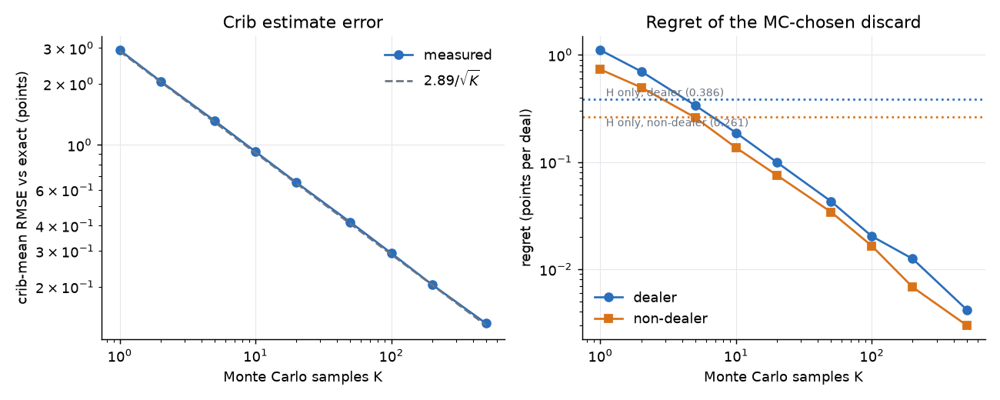
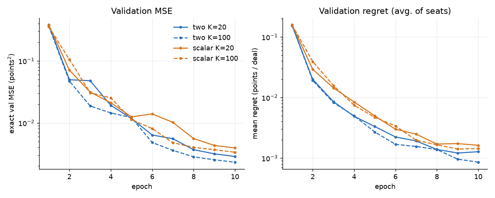
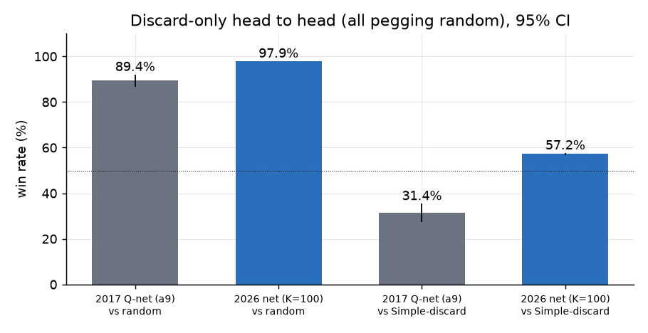
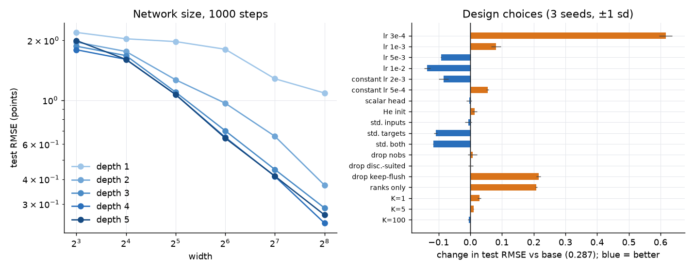

# Lab book: learning to discard in cribbage by supervised regression (23 – 24 Oct 2026)

*Reconstructed from one Claude Code chat session (`discord-modelling-session.jsonl`, 2026-10-23 10:53 UTC
to 2026-10-24 17:20 UTC), plus the artefacts that session left on disk: `data/runs/*.json` (the four full
training runs), `data/ablation.jsonl` (the ablation study) and the git history. Times are UTC; the machine
is at UTC+2, so file timestamps read two hours later. Numbers that come from the chat are quoted as
printed there; figures 1–4 were drawn for this document from the same numbers or from the on-disk
result files. Statements marked **(inferred)** are my reading, not something recorded in the session. The
module written in the session was called `cribbage/discard_expt_2026.py`; on 2026-10-25 (commit
`e0c12bf`) it was split into `cribbage/discard_model.py` (labels, dataset, network, training, head to
head) and `cribbage/discard_study.py` (the sample-size study and the ablation study), so command lines
below use the new module names.*

---

## 0. Summary

**The question.** The 2017 experiment ([2017_discard_modelling.md](2017_discard_modelling.md)) tried to
learn the *discard* decision (which two of six dealt cards to throw into the crib) from the outcomes of
whole games, with double Q-learning. It reached an 89 % win rate against a random player, but lost to a
hand-written Monte Carlo discarder, 31 % to 69 %. In October 2026 the question was turned round:
**if the target is just "expected points", can a small PyTorch network learn the discard decision
directly from exactly computed or Monte Carlo labels, how many Monte Carlo samples do those labels need,
and what in the network and training set-up actually matters?**

**How close to an answer?** Close, for the "expected points" objective.

| Question | Answer from this session |
|---|---|
| Can a network reproduce the exact expected-points discard? | **Yes.** Four full runs reach a test RMSE of 0.048–0.053 points and a regret of about 0.001 points per deal; the best pick is the exact optimum in 97–98 % of hands (§5). |
| Is it better than the 2017 Q-network? | **Much.** Against the same hand-only Monte Carlo opponent (random pegging on both sides) it wins **57.2 %** over 40 000 games, where the Q-network won 31.4 % of 500. Against a random player: 97.9 % vs. 89.4 % (§6). |
| How many Monte Carlo samples are needed for the crib term? | For choosing a discard at play time, K ≈ 50–100 (regret 0.02–0.04 points per deal); for training labels, K = 20 is enough, because label noise is unbiased and averages out (§3, §5, §8). |
| Does it matter that the opponent's crib throws are uniformly random? | **A little.** A policy opponent shifts the average crib by about ±0.5 points but changes the best discard in only about 5 % of hands beyond noise; it costs about 0.02 points per dealer hand and nothing as non-dealer (§9). |
| Which design choices matter? | In a short 1000-step regime: learning rate, scaling the targets, and the optimiser schedule dominate; the keep-flush feature must stay; two heads, K, init and most other features barely matter; a 3×64 net is well short of 3×256 (§7). **The longer-training questions are not answered.** |
| Is the playing strength of the final model known to be as good as the labels? | It is bounded by the labels: it learns *expected points under uniform-random opponent throws* and cannot do better than that objective (§10). |

What was never done: the ablation was run at 1000 steps only (the full runs used about 10 000), no
one-factor result was followed up with long runs, the combination of the better settings was not tried,
a score-aware discard (win probability rather than expected points) was not attempted, and nothing was
committed during the session (the work landed in commits `d2a2fe6`, `d20e97e` and `85ddfea`).

---

## 1. Background: what the 2017 work left open

Quoted from the first message of the session, which asks for a review of the 2017 code (what worked, what
was abandoned, how far it got) and for thoughts on modernising it with PyTorch, on pre-training with an
autoencoder, and on embedding game states word2vec-style.

The review found a discard-only Q-learner that plateaued at about 0.88 against a random player, a hand-
written baseline that reached about 0.97, an autoencoder that was a side experiment, and no pegging model.
The two further things the chat established, both already written up in the 2017 lab book:

* **The 2017 learning curves were misread at first.** The orange "validation error" in
  `discard_models.ipynb` is a *win rate against random* (higher is better), and the sawtooth in the blue
  training-error curve is a logging bug in `netbuilder.build` (the error is reset on every 312-minibatch
  call but divided by the full 6 000-minibatch snapshot interval). Rescaling each point by 6000/*n* removed
  most of the sawtooth. The corrected per-minibatch loss (MSE over all 52 outputs) went from 6.7e-4 at 125 k
  minibatches to 3.7–3.8e-4 from 2 M on, so it fell and then flattened where the win rate flattened (typical
  TD error ≈ √(3.8e-4 × 52) ≈ 0.14 on a ±1 target). Training loss was not informative about quality.
* **How strong is each skill against a random opponent?** Re-reading the notebooks, the discard decision is
  worth far more than the pegging decision against a random player:

  | Matchup (500 games, from `notes.py` and the notebook) | Result |
  |---|---|
  | Simple (both skills) vs. random | 484/500 = 96.8 % |
  | Simple, smart discard + random pegging, vs. random | 483/500 = 96.6 % |
  | Simple, smart pegging + random discard, vs. random | 339/500 = 67.8 % |
  | 2017 Q-net (`a9`) + random pegging, vs. random | 447/500 = 89.4 % |
  | 2017 Q-net (`a9`) vs. Simple discard-only | 157/500 = 31.4 % |
  | Simple (both) vs. Simple (discard only) | about 60–65 % |
  | Simple (pegging only) vs. Simple (discard only) | 48/500 ≈ 10 % |

  (Early in the chat the 484–16 figure was wrongly called "discard only"; it was corrected in the next
  turn. The conclusion is unchanged.) Reading: a random opponent saturates the metric, so "beats random"
  hides most of what pegging is worth. Against a competent opponent pegging matters (full Simple beats
  discard-only Simple 60–65 %).

### The reframing (Oct 23, 11:21–11:44 UTC)

After the user restated what they had taken from the review, the chat converged on these points:

1. **Discard is a 15-way choice, not a 30-way (ordered pair) one.** The 2017 net has 52 outputs and picks
   two cards in sequence (6 × 5 = 30 ordered pairs). Choosing which two to throw is the same as choosing
   which four to keep, C(6,4) = C(6,2) = 15, the same `KEEP_COMBINATIONS` list the old Simple player uses.
   Better: score each of the 15 candidate (keep, discard) splits with one value network and take the argmax.
2. **The game-end ±1 reward is too distant** from a decision whose effect is a point or two out of 121,
   buried under about 15 rounds of card luck.
3. **The 347-unit one-hot state encoding is wasteful**; features closer to the game (rank counts, suit
   structure, nobs) should do better.
4. **Discard is not a deep RL problem.** It can be learned from a tight loop around deal and discard, with no
   game and no opponent: label each split with the expected points it leads to.
5. **Pegging is the more interesting RL problem** (not pursued in this session; see §11).

A worry raised and settled: "if dealer = hand + crib and non-dealer = hand − crib, aren't the crib points
double-counted? Should the crib weigh 0.5?" No. Each seat maximises its own point differential for the round.
The opponent's hand does not depend on my discards, so it is a constant, leaving H + C for the dealer
(the crib is mine) and H − C for the non-dealer (the crib is the opponent's). The two formulas are the same
objective seen from two seats; a 0.5 would only be right if the crib were split.

Encoding options were also discussed (embeddings with pooling, i.e. Deep Sets; sorted ranks), and the
recommendation was plain features: with 13 ranks and 4 suits there is no large vocabulary for an embedding
to compress, and rank counts make pairs, runs and fifteens into patterns the network can see directly.

---

## 2. The plan (Oct 23, 18:33 UTC)

The user asked for a single-module experiment, with three tasks: (1) find how much Monte Carlo is needed for
good crib estimates (they suggested a head-to-head `compare_players` run and a KL divergence on the crib
distribution), (2) build the supervised dataset, (3) a basic PyTorch trainer. The plan was discussed before
any code was written; the agreed adjustments were:

* **Compute the crib exactly as a gold standard.** For one candidate discard the unknowns are the starter
  (46 cards) and the opponent's two throws (C(45,2) = 990), i.e. 45 540 crib scores per split. That is far too
  slow for a million hands (≈ 147 ms per hand, §8) but fine for a few thousand test hands, so the Monte Carlo
  question becomes "how close is K samples to the truth", not "do two noisy things agree".
* **Measure with regret, not KL.** The decision depends only on the mean and the ranking of the 15
  candidates. *Regret* is the exact expected points of the exact-best split minus those of the chosen split,
  averaged over hands, in points per deal. KL on the crib distribution measures something the decision never
  uses; it would matter only for a win-probability objective and was deferred.
* **Common random numbers**: the same sampled (starter, opponent throws) set for all 15 candidates.
* **Head-to-head last.** `compare_players` has no seeds or duplicate deals, and 500 games has a standard error
  of about 2 %, bigger than the likely effect of K.
* **Store H[15] and C[15] separately** (the dealer flag only changes the sign of C), so one dataset serves both
  seats. Fixed-budget guess to be tested: many hands at small K beat fewer hands at large K.
* **Opponent model for v1: uniform random throws**, behind a small `OpponentThrowModel` interface so that a
  smarter model could be swapped in later. This is a property of how the dataset is labelled.
* Decisions by the user: module `cribbage/discard_expt_2026.py`; `torch` becomes a hard dependency in
  `pyproject.toml`.

**Definitions.** For one dealt hand there are 15 splits. `H[i]` is the exact expected score of the four kept
cards averaged over the 46 unseen starters. `C[i]` is the expected crib score given the two thrown cards,
averaged over starter and the opponent's two throws. The value of split *i* is `H[i] + C[i]` as dealer and
`H[i] − C[i]` as non-dealer. Card values are `rank + 13 × suit` (ranks `A234567890JQK`, suits `SHDC`); the C
scorer takes about 0.1 µs per call and its `crib=True` flag handles the five-card flush rule for cribs.

---

## 3. Stage 1 (Oct 23, ≈19:23 UTC): how much Monte Carlo does the crib need?

Code: `hand_values` (exact H), `crib_values_mc` (C with K samples), `exact_labels` (C by full enumeration),
`candidate_values`, and the `k-study` command (`python -m cribbage.discard_study k-study`). Seven unit tests
(the splits partition the hand, H equals a brute-force computation, the opponent model is a valid
distribution, Monte Carlo converges to exact) passed and mypy was clean. The study took 40 s on 8 cores:
500 random hands, 5 repetitions per K, labelled exactly.

Two scale facts: across the 15 splits the mean spread (max − min) is **5.89 points for H and 3.03 for C**, so
the crib decision is about half as big as the hand decision, and the **standard deviation of a single crib
score is 2.89 points**.



*Figure 1: left, the RMSE of the Monte Carlo crib mean against exact falls as 2.89/√K (dashed line; the data
fall on it). Right, regret of the chooser that uses K samples; dotted lines are the "H only" chooser that
ignores the crib.*

| Chooser | crib RMSE | dealer regret | s.e. | dealer optimal | non-dealer regret | s.e. | non-dealer optimal |
|---|---|---|---|---|---|---|---|
| random discard | – | 3.8131 | 0.0774 | 6.6 % | 3.9428 | 0.0909 | 6.2 % |
| H only (ignore crib) | – | 0.3858 | 0.0308 | 59.9 % | 0.2612 | 0.0259 | 72.0 % |
| K = 1 | 2.928 | 1.1042 | 0.0324 | 43.8 % | 0.7291 | 0.0265 | 48.9 % |
| K = 2 | 2.057 | 0.6988 | 0.0250 | 53.5 % | 0.4955 | 0.0182 | 55.8 % |
| K = 5 | 1.314 | 0.3369 | 0.0154 | 64.7 % | 0.2595 | 0.0119 | 65.7 % |
| K = 10 | 0.926 | 0.1871 | 0.0098 | 73.1 % | 0.1358 | 0.0082 | 74.5 % |
| K = 20 | 0.653 | 0.0992 | 0.0067 | 79.9 % | 0.0752 | 0.0050 | 80.4 % |
| K = 50 | 0.416 | 0.0430 | 0.0039 | 87.4 % | 0.0342 | 0.0030 | 86.6 % |
| K = 100 | 0.293 | 0.0203 | 0.0020 | 90.6 % | 0.0165 | 0.0018 | 90.4 % |
| K = 200 | 0.205 | 0.0125 | 0.0015 | 92.4 % | 0.0068 | 0.0009 | 93.8 % |
| K = 500 | 0.132 | 0.0042 | 0.0007 | 95.5 % | 0.0030 | 0.0005 | 96.8 % |

Reading:

* Crib RMSE follows σ/√K exactly. Regret falls roughly as 1/K (about 2× per doubling).
* Even a random discard loses only 3.8 points per deal against the best one; the crib is worth about 0.3
  points per deal (ignoring it costs 0.39 as dealer, 0.26 as non-dealer). K = 5 only matches "ignore the
  crib"; **K = 10 beats it**.
* For a *playing* chooser, K ≈ 50–100 brings regret to 0.02–0.04 points. For *training labels* the guess was
  K = 10–20, to be tested in Stage 3 (§5, §8).
* This is also why the head-to-head cannot resolve this question: at the K ≥ 50 level the differences are
  far smaller than the 2 % standard error of a 500-game match.

---

## 4. Stage 2 (Oct 23, ≈19:43–19:55 UTC): the supervised dataset

A `Dataset` class holds hands `(N, 6)`, `H (N, 15)`, `C (N, 15)` and metadata (`.npz`); `generate_dataset`
and a `generate` command build it in parallel. Each 500-hand chunk has its own seeded generator, so the result
is the same for any number of workers. `/data` was added to `.gitignore`. Tests: 13 passed.

**Suit-symmetry splits.** Labels are exactly invariant under relabelling the four suits (24 ways), and so are
the planned features. Hands are therefore assigned to train/validation/test (90/5/5 %) by a hash of their
suit-canonical form, so a test hand's suit twin can never appear in training. Checked: zero overlap between
the classes in train, validation and test.

| File | Hands | C labels | Time |
|---|---|---|---|
| `discard_val_exact.npz` | 2 000 | exact | 141 s |
| `discard_test_exact.npz` | 2 000 | exact | 151 s |
| `discard_train_k20.npz` | 1 000 000 | K = 20 | 104 s |
| `discard_train_k100.npz` | 1 000 000 | K = 100 | 197 s |
| `discard_train_k1.npz`, `discard_train_k5.npz` (added Oct 24 for the ablation) | 1 000 000 | K = 1, 5 | 83 s (K = 1) |

Sanity checks on the data:

* The K = 20 and K = 100 training sets contain the *same* hands, so the comparison between them is clean.
* The standard deviation of the difference of their C labels is **0.714** (theory with σ = 2.9: 0.710) and the
  mean difference is −0.0004, so the Monte Carlo noise is unbiased, as assumed.
* **Effective size is smaller than it looks:** the 1 M training hands fall into only about 581 k distinct
  suit-equivalent classes (≈ 42 % duplicates of another class, each with a different noise draw).
* Mean H is 4.77 (train), 4.81 (val), 4.72 (test); mean C 4.74 / 4.74 / 4.71. The training sets show a larger
  crib spread across splits (3.50) than the exact sets (3.03); this is Monte Carlo noise inflating the
  max − min, not a real difference.
* Throughput of the labeller: exact H 0.15 ms per hand; C at K = 20 0.10 ms, at K = 100 0.32 ms.

A later question, "is `_label_chunk` deterministic?", was answered with a test: the hands depend only on
`(seed, split, chunk)` (same task twice: identical; K = 5, K = 50 and exact give the same hands; asking for 30
hands gives the first 30 of 40; a different chunk differs). The Monte Carlo *labels* are deterministic for
fixed `(seed, split, chunk, num, k)` but are not a prefix across different `num`, because they draw from the
generator after the hands. (`default_rng([seed, 2, split, chunk])` hashes a list of integers, so different
lists give independent streams; `default_rng(seed + chunk)` would collide.)

---

## 5. Stage 3 (Oct 23, 20:02–21:21 UTC): the first network

### 5.1 What was built

* **Features** (`encode_hands`), computed on the fly per batch, **29 per split**: rank counts of the kept
  cards (13, values 0–4), rank counts of the thrown cards (13, values 0–2), a keep-flush flag, a thrown-cards-
  suited flag, and the expected nobs: the number of unseen cards in the suit of each kept jack, summed, over
  46. They are invariant to suit relabelling (tested). The 15 splits of a hand are scored independently by the
  same network.
* **`DiscardNet`**: an MLP applied to each split. `two` head: outputs (Ĥ, Ĉ) and predicts Ĥ ± Ĉ, with no dealer
  input. `scalar` head: takes the dealer flag as an input and outputs one value.
* **Training**: MSE on points, AdamW (weight decay left at 0.01), one-cycle learning rate with peak 2e-3,
  batch of 1024 hands (15 360 split rows), 10 epochs, the epoch with the best validation MSE is kept.
  Evaluated on exact validation and test labels with MSE, regret, and percentage of optimal choices.
* The design was honest "convention" and not tuned (the chat said so when asked, §7): 3 hidden layers of 256
  ReLU units chosen as a step up from the 2017 net (2 × 150) and after a timing check (0.11 s per step on this
  4-thread CPU; width 512 would be about 4× slower); AdamW as the safe default for regression; one-cycle
  because it warms up from lr/25 over the first 30 % of steps and then anneals by cosine to nearly zero.
* Inputs and targets are used raw. Measured ranges on the validation hands: keep rank counts 0–4 (mean 0.31,
  std 0.52), discard rank counts 0–2 (0.15, 0.37), keep flush 0/1 (0.011), discard suited 0/1 (0.24), nobs
  0–0.74 (0.07, 0.12); targets H 1.30–16.63 (mean 4.81, std 2.35), C 2.89–9.47 (4.74, 1.08), dealer value
  H + C mean 9.55 (std 2.52), non-dealer H − C mean 0.07 (std 2.65).
* Weights use `nn.Linear`'s default initialisation (uniform ±1/√fan_in; measured weight std 0.107 / 0.036 /
  0.036 against He 0.263 / 0.088 / 0.088), which is neither Glorot nor He. Activations shrink through the
  layers (std 0.195 → 0.080 → 0.043 with output std 0.03 at initialisation), which is why the first epoch's
  training loss is large.
* `torch` added to `pyproject.toml`; tests grew to 18 and mypy stayed clean.

### 5.2 Pilot (20:05 UTC)

100 k hands (K = 20), 6 epochs, **50 s**. The validation MSE per epoch was 5.04, 1.21, 0.60, 0.37, 0.30, 0.29
and the validation regret (dealer / non-dealer) 2.26 / 2.60, 0.54 / 0.53, 0.27 / 0.24, 0.16 / 0.14, 0.14 / 0.12,
0.13 / 0.11. Test regret 0.12 (dealer) and 0.11 (non-dealer) against 0.39 / 0.21 for "H only" and about 0.10 /
0.075 for a K = 20 Monte Carlo chooser (Stage 1). The pipeline learns, and it already beats ignoring the crib.

### 5.3 Four full runs (20:06 → 21:21 UTC)

Two heads × K ∈ {20, 100}, all on the full 1 M hands, same hands, epochs (10) and seed, so differences come
only from label noise and head design. The four runs, executed one after another, took about 75 minutes in all
(the chat's later remark of "about 30 minutes per model" does not match the 20:06 → 21:21 wall clock). Test set: 2 000 exact hands.

| Model | Test MSE | Dealer regret | Non-dealer regret | Optimal choice (D / N) |
|---|---|---|---|---|
| two-head, K = 20 | 0.0028 | 0.0012 | 0.0013 | 97.7 % / 97.3 % |
| scalar, K = 20 | 0.0039 | 0.0016 | 0.0019 | 97.3 % / 96.4 % |
| **two-head, K = 100** | **0.0023** | **0.0006** | **0.0011** | 98.0 % / 97.4 % |
| scalar, K = 100 | 0.0033 | 0.0011 | 0.0014 | 97.8 % / 97.5 % |
| *H only (ignore the crib)* | – | *0.385* | *0.207* | *63 % / 73 %* |



*Figure 2: validation MSE and mean regret by epoch for the four full runs (from `data/runs/*.json`).*

Reading:

* The RMSE against the exact values is about **0.05 points** (√0.0023 = 0.048) and the regret about 0.001
  points per deal, roughly 100× below "ignore the crib". The net is *more accurate than the noisy labels it
  learned from* (it also beats the K = 500 Monte Carlo chooser of Stage 1, regret 0.004 / 0.003), because
  label noise averages out over a million hands.
* **K = 20 is nearly enough for labels.** K = 100 labels have 5× less noise, yet the test MSE improves only
  from 0.0028 to 0.0023. This supports the fixed-budget guess made in the plan.
* **The two-head design wins at both K** (MSE 0.0028 vs. 0.0039 at K = 20 and 0.0023 vs. 0.0033 at K = 100),
  but it was a single seed and later (§7) the effect shrank to nothing in the short regime.
* The best epoch was the last one (10) in all four runs, so the networks were still improving when the
  schedule ended; the remaining gap is already tiny.
* Caveats stated at the time: the test set is small, so regret differences of about 0.0005 are probably
  noise (no standard errors were computed); MSE ordering is more reliable than regret ordering. The model is
  capped at the quality of its labels, i.e. it reproduces the exact solver's objective and does not exceed it.

---

## 6. Head to head against the old baselines (Oct 23, 21:25–21:31 UTC)

`LearnedDiscardPlayer`, `make_player`, `play_match` and a `head-to-head` command were added (tests now 20). The
harness seeds each game separately (`seed × 100000 + i`) and runs in parallel. **Both seats play pegging at
random**, so only the discard policy differs. A self-play check on 2 000 games gave 47.7 % ± 2.2 %, then the
real runs used 40 000 games each:

| Matchup (40 000 games, seed 7) | Wins for first player | 95 % CI | Wall time |
|---|---|---|---|
| model (two-head, K = 100) vs. `simple-discard` | **22 861 = 57.2 %** | ± 0.5 % | 93 s |
| `simple-discard` vs. `simple-discard` (harness check) | 20 008 = 50.0 % | ± 0.5 % | 95 s |
| model vs. random | 39 149 = 97.9 % | ± 0.1 % | 57 s |



*Figure 3: discard-only comparison with the 2017 Q-network (a9). The 2017 numbers are from 500 games each,
the 2026 numbers from 40 000. 95 % intervals for the 2017 bars are my binomial calculation.*

* **The harness is fair**: self-play is exactly 50.0 %, so there is no seat or dealer bias.
* **The gap is real**: 57.2 % is about 14 standard errors from 50 %.
* Against Simple's hand-only discard, the 2017 Q-network won 31.4 % and this model wins 57.2 %. Against
  random it goes 89.4 % → 97.9 %. (The 97.9 % vs. 96.6 % for Simple is within the noise of the old 500-game
  figure, about ± 0.8 %.)
* *Why it wins* (not separated in the session): Simple's discard keeps the four cards with the best expected
  *hand* (from 20 sampled starters) and ignores the crib; the model values the crib (about 0.3 points per deal)
  and has accurate hand values. An exact-H-only chooser would show how much of the margin comes from the
  crib and how much from Simple's sampling noise. **Not run.**
* Not run: the model against full Simple (greedy pegging), and K = 20 / scalar variants head to head (their
  regret is slightly worse, and the win-rate differences should be tiny).

**Speed** (Oct 23, 21:34 UTC; single process, 400 random hands):

| Chooser | Cost |
|---|---|
| random | 2 µs per discard |
| Simple (20 starters, hand only) | 240 µs per discard |
| K = 100 model, one hand per call | 315 µs per discard |
| K = 100 model, batched (20 000 hands) | 75 µs per hand |
| labeller: exact H + Monte Carlo crib, K = 100 | 431 µs per hand |
| labeller: exact H + exact crib | 146 691 µs per hand |

Both choosers are dominated by Python overhead (Simple makes 300 scorer calls of about 0.1 µs; the network's
time is feature building and PyTorch dispatch), so the model is not cheaper than Simple at play time, and in a
whole game the engine dominates (about 19 ms of CPU per game). Exact crib labels cost about 340× more than
K = 100, which is why the exact sets are 2 000 hands.

---

## 7. Stage 4 (Oct 24): what the network is made of — questions, then an ablation

### 7.1 Clarifying questions (Oct 24, 11:35–12:29 UTC)

The user asked about `default_rng` on integer lists, determinism of `_label_chunk` (§4), the `torch.gather`
nobs computation, the origin of the architecture and optimiser, one-cycle schedules, input and output
scaling, and weight initialisation. The honest summary given for the design: **width, depth, optimiser,
learning rate, batch size and epochs were conventional defaults and one pilot, never swept**, and "the best
epoch was the last one" means the schedule ended while the model was still improving. The user then asked for
an ablation study: "might be cool to know if we could get good performance from a smaller net. also i'd love
to know if you could report on the effects of some of the design choices we've been talking about".

### 7.2 Design (Oct 24, 13:33–13:44 UTC)

`TrainConfig` gained switches for the schedule (one-cycle or constant), initialisation (default or He),
standardising inputs and targets, and dropping feature groups. Defaults unchanged; `two_k100.pt` was checked
to load and score identically (test MSE 0.0023). Tests: 25 passed, mypy clean. The K = 1 and K = 5 training
sets were generated for the label-noise group.

* **Base**: two-head 3 × 256 net, lr 2e-3 with one-cycle, default init, raw inputs and targets, all features,
  K = 20 labels, **100 k training hands, 1 000 gradient steps (about 11 epochs)**.
* One change per variant, **3 seeds each** (seeds vary initialisation and batch order; the training hands
  are the same), judged on the 2 000 exact test hands. "± " is the sd over seeds, the yardstick for noise.
* A timing probe: 300 steps of the base net give a test RMSE of ≈ 0.7 against 0.05 for the full 10 000-step
  runs, so this is a **short-training regime** in which a variant that wins may simply learn faster.
* Run: stage A (size, heads, learning rate) then stage B (schedule, init, scaling, features, K, data),
  13:44 → ≈ 15:48 UTC, 123 runs, no errors. The results are in `data/ablation.jsonl` (resumable; re-running
  `ablate` skips finished runs). The 4 × 256 base-size run takes about 450 s; a 1 × 16 net about 5 s.
* After the report, the user asked how to add depth 4. One line was changed (`for depth in (1, 2, 3, 4)`)
  and the resumable command was given. **The depth-4 and depth-5 rows (36 more runs) are in the file on disk
  but the session does not show them being run**; I assume the user ran them after 16:38 UTC (the file was
  last written at 19:06 local time) **(inferred)** and include them below.

### 7.3 Results: network size

Test RMSE in points (mean of 3 seeds, 1 000 steps):

| depth \ width | 8 | 16 | 32 | 64 | 128 | 256 |
|---|---|---|---|---|---|---|
| 1 | 2.193 | 2.037 | 1.973 | 1.805 | 1.282 | 1.087 |
| 2 | 1.962 | 1.758 | 1.267 | 0.965 | 0.658 | 0.373 |
| 3 | 1.870 | 1.677 | 1.097 | 0.701 | 0.448 | **0.287** (base) |
| 4 | 1.794 | 1.606 | 1.068 | 0.650 | 0.414 | 0.241 |
| 5 | 1.997 | 1.604 | 1.067 | 0.644 | 0.415 | 0.264 |



*Figure 4: left, network-size grid (log scales). Right, change in test RMSE from the base (0.287), blue =
better, shaded band = ±1 sd of the base across seeds; error bars are ± 1 sd of each variant.*

Selected parameter counts, RMSE ± sd, regret and optimal-choice rate:

| Net | Parameters | Test RMSE | Regret | Optimal | Train time |
|---|---|---|---|---|---|
| 3 × 256 (base) | 139 778 | 0.287 ± 0.003 | 0.040 | 86.4 % | 326 s |
| 4 × 256 | 205 570 | 0.241 ± 0.011 | 0.027 | 88.2 % | 319 s |
| 5 × 256 | 271 362 | 0.264 ± 0.026 | 0.034 | 87.1 % | 503 s |
| 2 × 256 | 73 986 | 0.373 ± 0.009 | 0.068 | 83.5 % | 199 s |
| 4 × 128 | 53 634 | 0.414 ± 0.011 | 0.078 | 81.4 % | 101 s |
| 3 × 128 | 37 122 | 0.448 ± 0.026 | 0.094 | 80.0 % | 113 s |
| 3 × 64 | 10 370 | 0.701 ± 0.012 | 0.224 | 71.8 % | 44 s |
| 2 × 32 | 2 082 | 1.267 ± 0.116 | 0.746 | 52.8 % | 30 s |
| 1 × 256 | 8 194 | 1.087 ± 0.004 | 0.521 | 60.6 % | 73 s |

* **Depth helps more than width at equal parameter count** (3 × 64: 10 k parameters, RMSE 0.70; 1 × 256: 8 k
  parameters, RMSE 1.09), but returns diminish: depth 3, 4 and 5 are within noise at widths ≤ 128.
* **No small net matches the base at 1 000 steps.** Roughly 37–74 k parameters are needed to come close
  (3 × 128: 0.45, 2 × 256: 0.37).
* **Whether a small net would eventually match is open.** The small nets were still improving when
  the runs stopped; the follow-up proposed in the chat (10 000-step runs of 3 × 64 and 3 × 128 with the
  better settings below) was **not run in the session**.

### 7.4 Results: other design choices

(Change in RMSE from the base 0.2866; negative is better. The seed sd of the base is 0.003.)

| Group | Variant | Test RMSE | Change | Regret | Optimal |
|---|---|---|---|---|---|
| heads | scalar head (dealer flag as input) | 0.283 ± 0.010 | −0.004 | 0.037 | 86.4 % |
| learning rate | 3e-4 | 0.903 ± 0.025 | +0.616 | 0.359 | 65.4 % |
| | 1e-3 | 0.368 ± 0.018 | +0.082 | 0.066 | 83.1 % |
| | **5e-3** | 0.194 ± 0.002 | −0.092 | 0.019 | 90.0 % |
| | **1e-2** | **0.151 ± 0.012** | **−0.136** | **0.011** | **92.6 %** |
| schedule | constant 2e-3 | 0.203 ± 0.019 | −0.084 | 0.019 | 90.5 % |
| | constant 5e-4 | 0.341 ± 0.005 | +0.055 | 0.056 | 84.2 % |
| init | He | 0.301 ± 0.009 | +0.014 | 0.044 | 84.8 % |
| scaling | standardise inputs | 0.280 ± 0.013 | −0.006 | 0.042 | 86.2 % |
| | **standardise targets** | 0.178 ± 0.007 | −0.109 | 0.015 | 90.8 % |
| | standardise both | 0.170 ± 0.001 | −0.117 | 0.014 | 90.9 % |
| features | drop nobs | 0.294 ± 0.018 | +0.007 | 0.043 | 85.6 % |
| | drop discard-suited | 0.288 ± 0.010 | +0.002 | 0.041 | 86.2 % |
| | **drop keep-flush** | 0.502 ± 0.008 | +0.215 | 0.151 | 80.4 % |
| | ranks only (drop all three) | 0.495 ± 0.004 | +0.208 | 0.149 | 80.5 % |
| label noise | K = 1 | 0.315 ± 0.006 | +0.029 | 0.046 | 85.6 % |
| | K = 5 | 0.297 ± 0.001 | +0.010 | 0.042 | 86.3 % |
| | K = 100 | 0.282 ± 0.003 | −0.005 | 0.037 | 87.0 % |
| data | 3 000 hands | 0.351 ± 0.005 | +0.064 | 0.053 | 84.3 % |
| | 10 000 hands | 0.304 ± 0.020 | +0.018 | 0.043 | 85.8 % |
| | 30 000 hands | 0.290 ± 0.006 | +0.003 | 0.041 | 86.1 % |
| | 300 000 hands | 0.259 ± 0.012 | −0.028 | 0.031 | 87.6 % |
| | 1 000 000 hands | 0.167 ± 0.006 | −0.120 | 0.014 | 91.4 % |

Reading:

* **Learning rate, target scaling and the schedule dominate.** The chosen 2e-3 was too low for this regime
  (best tested: 1e-2, RMSE 0.15). Standardising the targets cut the RMSE by 38 %; the raw targets start far
  from the network's initial output scale. Constant 2e-3 beat one-cycle at 1 000 steps, **(inferred)** because
  the one-cycle schedule spends 30 % of a short run warming up.
* **Inputs**: standardising them changes nothing (the features are all O(1)); contrast with 2017, where
  scaling the 347 mostly one-hot inputs was the first thing that made Q-learning move.
* **Heads**: no accuracy difference (0.283 vs. 0.287), but the scalar head trained 1.9× slower per step (608 s
  vs. 326 s), so the two-head design stays on cost, not accuracy.
* **Features**: **keep-flush is the one that matters** (dropping it costs 0.22 RMSE). Nobs and discard-suited
  are inside the noise at this training length. Nobs is a real part of the score, so it was kept.
* **Label noise**: K = 1 costs 0.03, K = 5 0.01, K = 100 buys −0.005. K = 20 is a reasonable choice.
* **Init**: He is no better than the default (+0.014, about the size of the noise).
* **Data amount is confounded.** Epochs were set as `ceil(steps / steps_per_epoch)`, so the 1 M run did about
  1 950 steps, the 300 k run about 1 170 and the 100 k run about 1 080. The −0.12 for 1 M is more steps, not
  more data. The 3 k, 10 k and 30 k rows (+0.064, +0.018, +0.003) suggest data barely limits things below
  100 k hands at this training length.

### 7.5 What this ablation does and does not say

* It is a **1 000-step** study. The full runs reached 0.048 RMSE in 10 000 steps; here the best variant is at
  0.15. A variant that "wins" may learn faster without ending up better; the claims are about speed of
  learning unless confirmed by longer runs.
* Effects may not stack (high lr + standardised targets + constant schedule was **not** run as a combination).
* Single training set; seeds vary initialisation and batch order only. The test set has 2 000 hands, so
  regret differences below about 0.01 are noise; RMSE is the more reliable metric.
* The follow-up proposed in the chat (10 000 steps for the small nets with lr 5e-3 and standardised targets)
  was **not run**.

---

## 8. Putting the Monte Carlo question together

The original question (1) of the plan was "how much Monte Carlo is needed?". There are three answers,
depending on what the samples are for.

| Use of the samples | Evidence | Answer |
|---|---|---|
| Choosing a discard at play time (Monte Carlo chooser) | §3: regret 0.10 / 0.075 at K = 20, 0.043 / 0.034 at K = 50, 0.020 / 0.017 at K = 100 | K ≈ 50–100 for regret ≤ 0.04 |
| Labels for a regression network | §5.3: K = 20 → 0.0028 MSE, K = 100 → 0.0023; §7.4: K = 1 → +0.029 RMSE, K = 5 → +0.010, K = 100 → −0.005 | K ≈ 5–20; more hands at small K beat fewer hands at large K |
| Test and validation labels | exact enumeration is affordable for 2 000 hands (≈ 147 ms per hand) | exact |

---

## 9. Does the uniform-opponent assumption matter? (Oct 24, 16:48–17:06 UTC)

The user wondered whether `two_k100.pt` could generate a dataset in which the opponent's crib throws follow a
strong policy rather than uniformly random cards. The chat first laid out what it would involve (a
`PolicyThrows` class behind the existing interface; the crib term would then depend on *who owns the crib*,
so C splits into a dealer and a non-dealer quantity and the Ĉ head needs the dealer flag; exact labels
disappear, since the opponent has about 9.4 M possible hands, so validation would use K ≈ 500; labelling
becomes batch-network bound; the result is only as strong as the one opponent used; iterating may cycle)
and then proposed a cheap check before any investment: take test hands, label them both ways, and see how
often the best discard changes.

Script (kept in the scratchpad, nothing changed in the repo): for 1 000 test hands, K = 500 policy
completions per hand with the opponent policy `two_k100.pt`, compared with the exact uniform labels. A
300-hand pilot (K = 300) gave similar numbers.

| | me dealer (opponent throws into my crib) | me non-dealer (opponent throws into its own crib) |
|---|---|---|
| Mean crib shift vs. uniform | −0.52 points | +0.56 points |
| Per-split shape change (rms) | 0.19 | 0.17 |
| Best uniform discard loses (vs. policy labels) | **0.029** points | 0.010 points |
| Best discard changes | 10.9 % | 7.0 % |
| Noise floor (two policy replicates): regret / changes | 0.008 / 5.6 % | 0.009 / 7.0 % |

* The average crib moves by half a point in the expected direction (a defensive non-dealer throws less into
  my crib; a dealer keeps crib-friendly cards for its own). The shift is the same for every discard, so it
  does not change which one is best; the part that changes the ranking of the splits is about 0.18 points rms.
* **Non-dealer**: the uniform-trained choice is already as good as the policy-trained one (0.010 vs. a 0.009
  noise floor). **Dealer**: a real but small effect (0.029 vs. 0.008), about 5 % more hands with a different best
  discard than the noise floor.
* Conclusion in the chat: worth about **0.02 points per dealer hand** against this opponent and nothing as
  non-dealer, small next to the 0.4-point cost of choosing by hand alone; building a policy-opponent dataset
  is **low priority**. Caveat: only one opponent (the model itself) was tried.

---

## 10. How close to an answer?

**What is established**

1. For the objective "expected point differential under a uniformly random opponent throw", a small
   rank-count network learns the discard decision essentially perfectly (RMSE ≈ 0.05, regret ≈ 0.001 points per
   deal, 97–98 % exact-optimal choices), from under 20 minutes of CPU training per model on a million labelled hands
   (and a tiny regret already after 50 s on 100 k hands).
2. That model beats the 2017 Q-network by a wide margin in a like-for-like discard-only comparison, and beats
   the hand-only Monte Carlo discarder 57.2 % ± 0.5 % over 40 000 games.
3. The Monte Carlo sample-size question has the quantitative answers in §8.
4. Within the 1 000-step ablation: learning rate, target scaling and schedule matter most; keep-flush must be
   kept; head design, init, nobs, discard-suited and K ≥ 5 barely matter.
5. Policy-dependent crib modelling would add very little against the opponent tested (§9).

**What is not established**

* The ablation's conclusions have not been checked at convergence (all runs 1 000 steps), nor in combination.
* Whether a net of 10–40 k parameters reaches the base net's accuracy given more steps.
* The head-to-head used random pegging, so the result says nothing about discard *in the presence of* pegging
  (the 2017 work found that full Simple beat discard-only Simple, so pegging matters against a good player).
* The reason for the 57.2 % margin (crib term vs. less noisy hand values) was not isolated.
* The model optimises *expected points*, not win probability; near the end of a game these differ, which is
  where a score-aware learned value could add something. Not attempted.
* One training set; seeds vary only initialisation and batch order. The opponent model is uniform.

---

## 11. Timeline (UTC)

| When | Work |
|---|---|
| Oct 23 10:53–11:05 | Review of the 2017 experiments; reading the notes, `expt.py`, `dqlearning.py`, `neural.py` and the model metadata; first summary. |
| 11:05–11:39 | Discard vs. pegging against a random opponent; correction of the 484–16 attribution; the 2017 plots explained (win rate, sawtooth bug); the user restates the lessons. |
| 11:43–12:04 | Crib double-counting question; the 15 keeps; embeddings, pooling and sorted ranks. |
| 18:33 | Planning discussion: exact crib as gold standard, regret metric, common random numbers, H/C stored separately, uniform opponent v1. |
| 19:17–19:24 | Stage 1: `discard_expt_2026.py`, `OpponentThrowModel`, 7 tests, K study (40 s). |
| 19:43–19:55 | Stage 2: `Dataset`, `generate`, suit-symmetry splits; 4 datasets generated (≈ 10 min). |
| 20:01–20:06 | Stage 3: features, `DiscardNet`, trainer; 18 tests; pilot (50 s); four full runs launched. |
| 21:21 | Four runs finish; results table. |
| 21:25–21:34 | Head to head (40 000 games × 3 matchups); speed comparison. |
| Oct 24 11:35–12:29 | Questions: seeding, determinism, nobs gather, architecture and optimiser provenance, scaling, init. |
| 13:33–13:44 | Ablation code (`TrainConfig` switches), K = 1 / 5 datasets, timing probe, run launched. |
| ≈ 15:48 | Ablation finishes (123 runs); report. |
| 16:38 | Depth 4 added to the sweep; (depth 4 and 5 appear on disk later). |
| 16:48–17:06 | Policy-opponent labels discussed; label-disagreement check run. |
| 17:19 | Handoff: a prompt for the pegging investigation, written for a new session. |

**Git** (author dates): `d2a2fe6` (2026-10-23) *discard_expt_2026*; `d20e97e` and `85ddfea` (10-24) *NN config
ablation* and *more ablation*; `e0c12bf` (10-25) *rename modules and change project layout*.

---

## 12. Reproducing

```
python -m cribbage.discard_study k-study --hands 500 --reps 5
python -m cribbage.discard_model generate --split val  --hands 2000 --k exact --out data/discard_val_exact.npz
python -m cribbage.discard_model generate --split test --hands 2000 --k exact --out data/discard_test_exact.npz
python -m cribbage.discard_model generate --split train --hands 1000000 --k 100 --out data/discard_train_k100.npz
python -m cribbage.discard_model train --train data/discard_train_k100.npz --head two --epochs 10
python -m cribbage.discard_model head-to-head --a model:data/runs/two_k100.pt --b simple-discard --games 40000 --seed 7
python -m cribbage.discard_study ablate --out data/ablation.jsonl --steps 1000 --seeds 3 --procs 4 --threads 2
python -m cribbage.discard_study ablate-report
```

(Subcommand names and flags are as used in the session; the module split on Oct 25 may have changed some
options, check `--help`.) Datasets, models and ablation results are in `data/` (git-ignored): `data/runs/`
has `two|scalar_k20|k100.{json,log,pt}`, and the ablation file has 159 rows, 41 variants × 3 seeds plus the
extra depths. The label-disagreement script lived only in the session scratchpad and is not preserved.

**Open items carried forward** (all from the chat): long runs of the small nets with the better settings;
the combination of high learning rate, target standardisation and constant schedule; a variant of the
head-to-head that isolates crib value (an exact-H-only chooser); the policy-opponent dataset (judged low
priority, §9); a score-aware (win-probability) discard value; and the pegging investigation, for which the
session ended by writing a prompt (the opening of the pegging lab book).
