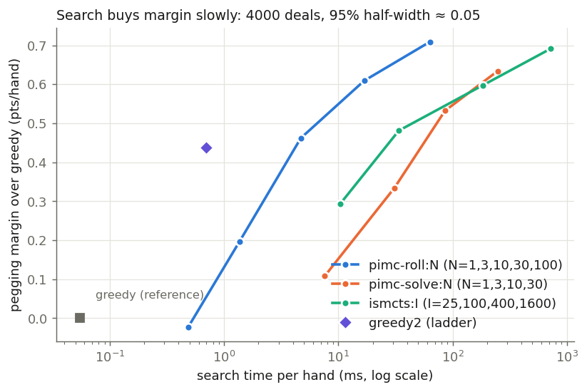
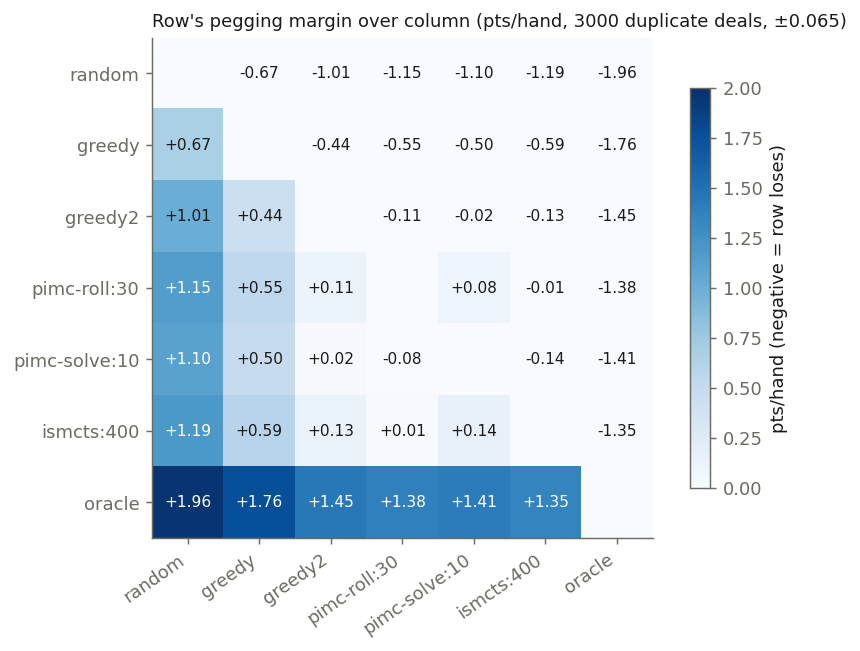
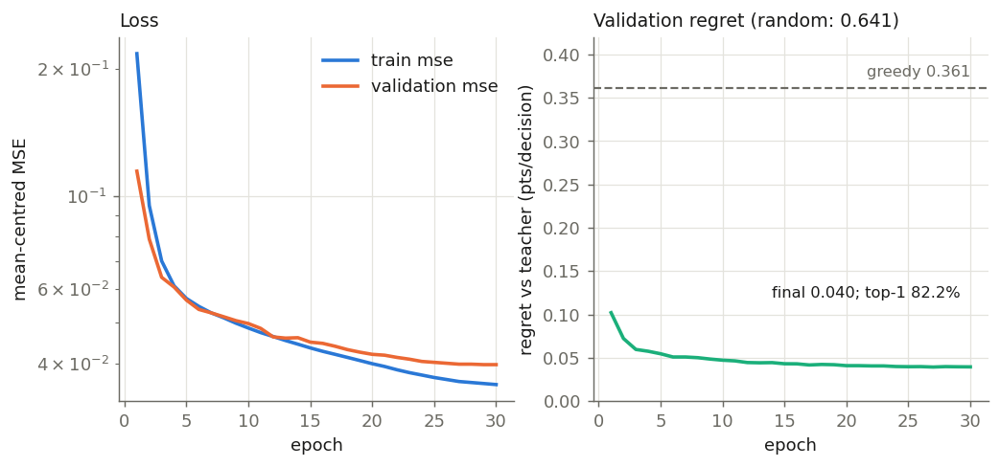
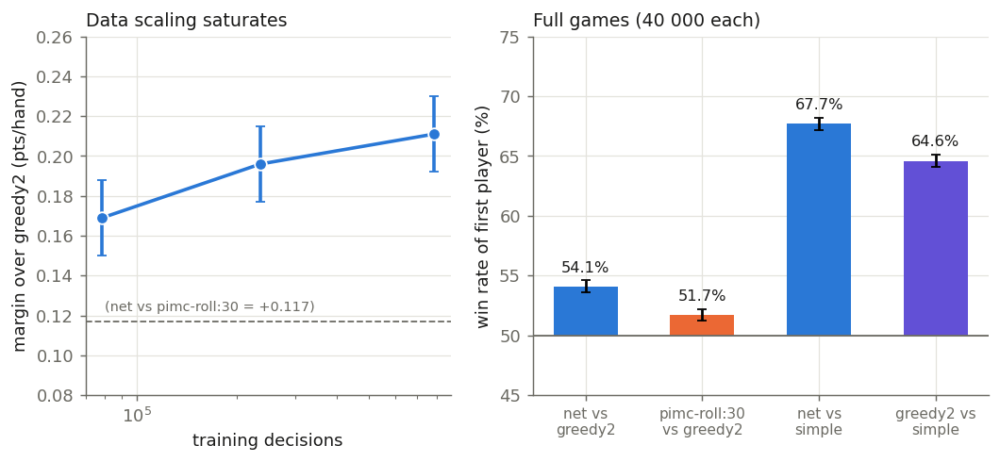

# Lab book: how much is pegging worth, does search help, and can a network learn it? (24 – 25 Oct 2026)

*Reconstructed from one Claude Code chat session (`pegging-modelling-session.jsonl`, 2026-10-24 17:20 UTC to
2026-10-25 22:58 UTC; the context was compacted once, at the very end), plus the result files it left in
`data/pegging/` and `data/pegging/rl/` (`ladder.txt`, `calibrate.txt`, `opp.txt`, `compare.txt`, `train.log`,
`sub.log` and others) and the git history. Times are UTC; the machine is at UTC+2, so commit times and file
timestamps read two hours later. Numbers are quoted as printed in the session or the result files; figures 1–4
were drawn for this document from those numbers (`train.log` for figure 3). Statements marked **(inferred)** are
my reading, not something recorded in the session. The code was written as `cribbage/pegging_expt_2026.py` and
`cribbage/pegging_rl_expt_2026.py`; on 2026-10-25 the codebase was refactored (commits `2c08365`–`b15dee2`) and
those became `cribbage/pegging.py`, `pegging_policy.py`, `pegging_search.py`, `pegging_bench.py`, `pegging_model.py`
and `specs.py`, so command lines below use the new names. "Simple" is the 2017 hand-written player (expected-score
discard, greedy pegging), now spelled `expected+greedy` or `simple`.*

---

## 0. Summary

**The questions.** The earlier discard work ([2017](2017_discard_modelling.md), [2026](2026_discard_modelling.md))
left pegging (the `play_card` decision, where the players lay cards alternately and score for 15s, pairs, runs, 31
and go) untouched; in 2017 pegging was never learned, and a hand-written Monte Carlo player won mostly through its
discards. In October 2026 three questions were asked, and a fourth came out of the answers:

1. **How much does pegging skill matter?** With the discard policy fixed (the trained network `two_k100.pt`), swap
   only `play_card`: random, 1-ply greedy, something stronger. Win-rate gaps and points per hand.
2. **How strong can pegging get with search?** (Determinised sampling of the opponent's hidden cards, rollouts or
   minimax, ISMCTS, plus an oracle that sees the opponent's hand as a ceiling.)
3. **Is the search worth its cost?**
4. **Can a network learn pegging, and beat greedy2 or the search it learned from?** (The user's RL question.)

**How close to an answer?** Questions 1–3 have clear answers. Question 4 has a clear positive answer for
*supervised regression on search values*; the original question of whether *reinforcement learning* as such would
work was not tested.

| Question | Answer from this session |
|---|---|
| How much is pegging skill worth? | A lot. Against random pegging, greedy gains **+0.73 pts/hand = 63.2 % win rate**; a cheap 2-ply rule ("greedy2") gains **+1.04 pts/hand = 69.4 %** (20 000 deals / 4 000 games, §3, §5). The exchange rate is about **1.8 pp of win rate per 0.1 pt/hand** (least-squares through 50 %). |
| Where is the ceiling? | The oracle that sees the opponent's hand is **+1.35 to +1.45 pts/hand** above every honest policy. That is the value of the hidden information and it cannot be recovered by any honest policy (§4). |
| Does search help? | Only a little over greedy2. pimc-roll:30 beats greedy2 by **+0.081 ± 0.020 pts/hand** (20 000 deals) and wins **51.7 % ± 0.5 %** of 40 000 full games (§6). Gains flatten beyond about 30 sampled worlds. |
| Is it worth the cost? | greedy2 gets most of the gain at about 1/30 of the time of pimc-roll:30 (0.7 ms vs 16–26 ms per hand). Exact minimax per sampled world costs about 5× more than rollouts for the same strength (§4, §5). |
| Against the 2017 hand-written player? | The discard network + greedy2 beats full Simple **64.6 % ± 0.5 %** (40 000 games); with the learned pegging network **67.7 % ± 0.5 %** (§7, §11). |
| Can a network learn pegging? | **Yes.** A 3×256 MLP regressed on 785 k pimc-roll:100 labels beats greedy2 by **+0.211 ± 0.019 pts/hand** and pimc-roll:30 by **+0.117 ± 0.018**, and wins **54.1 % ± 0.5 %** of 40 000 full games against greedy2. It costs about 0.4 ms/hand, against 20 ms for pimc-roll:30 (§8, §11). |
| Can it be improved beyond its teacher by iterating? | **Not shown.** Search that rolls out with the network is not measurably better than the network (−0.051 ± 0.041 and +0.035 ± 0.052), so there is no stronger teacher to distil (§9). More data of the same kind adds little (§10). |
| Is the network behind its teacher? | **No.** It beats pimc-roll:100, the search that made its labels, by **+0.038 ± 0.015 pts/hand** at 1/40 of the cost (§13). |
| Does using the opponent's earlier "go" help? | It is correct but rare (2.3 % of contested decisions) and has no measurable effect (−0.001 ± 0.019, §12). |

What was **not** done: no policy-gradient or Q-learning (the "RL" of the question); the strategy-fusion hypothesis
(why exact-solve search is no better than rollouts) was suggested and never tested; no score-aware pegging (the
objective is pegging-point margin only, ignoring the game score); the network was not compared to ISMCTS-1600 (against
pimc-roll:100 it was, §13); every experiment used one training run and one set of seeds; the 40 000-game results of §11 were not
saved to a file (they are quoted from the chat); and the discard model was held fixed throughout.

---

## 1. Background and setup

### 1.1 What was known before

* The 2017 lab book found that, against a random player, discarding well is worth much more than pegging well:
  Simple with discard only beat random 97.6 % of games, with pegging only 67.8 %.
* The October 2026 discard work (previous day, 23–24 Oct) produced `data/runs/two_k100.pt`, a discard network that
  beats Simple's discard 57.2 % over 40 000 games when both peg at random. It is the fixed discard policy
  everywhere below, so differences between players come from `play_card` only.
* The repo had `SimpleCribbagePlayer` with a 1-ply greedy `play_card` (play the card that scores most right now)
  and a `compare_players`/`play_match` harness for head-to-head games.

### 1.2 The session's first message and the approved plan (24 Oct, 17:20–17:43 UTC)

The first message asked for **investigation and a plan, with no code until approved**, and spelled out the three
questions, the things to check (what state pegging exposes; how to measure pegging in isolation with fixed
deals and duplicate seats; the information structure) and the constraints (one new module with a CLI, tests in
`cribbage/test/`, generated data in git-ignored `data/`, mypy clean, speed).

The assistant read the engine and ran a small probe (4 000 random 4-card deals, not repo code) to ground the cost and
noise estimates:

| Setup (probe, 4 000 random-hand deals) | Margin (pts/hand) | SD | Note |
|---|---|---|---|
| random vs random, one fixed seat | −1.095 | 2.44 | **seat bias of 1.1 points** with identical players |
| random vs random, duplicate | −0.045 | 3.27 | seat bias cancels |
| greedy vs random, one fixed seat | −0.477 | 2.72 | |
| greedy vs random, duplicate (per pair of plays) | +1.487 | 3.59 | ≈ +0.74 per hand-play |
| greedy vs greedy | 5.886 total peg pts/hand | 2.86 | |

Findings that shaped the design:

* **Seat bias is large.** The non-dealer scores about 1.1 points less per hand than the dealer, even with identical
  players, so every comparison is a *duplicate-deal* one: each deal is played twice with the seats swapped, and the
  margin is averaged. The probe also showed duplication cuts variance only about 10 %; the main benefit is exact seat
  balance, and a larger gain comes from running every policy on the same deals (common random numbers).
* **Pegging-only play is cheap**: about 40 µs for a full pegging phase including `Round` overhead. A million deals
  take about a minute, so noise in the harness is no problem; the cost is the search.
* **Cost surprise.** The user had quoted about 240 µs per Simple decision; the assistant measured about 2.6 µs per
  `play_card` (C scorer) and guessed 240 µs may be Simple's discard step **(inferred)**.
* **Information structure.** Opponent holds 4 of about 45 unseen cards; the two crib cards stay hidden. The
  search samples the opponent's hand uniformly from the unseen cards (with the "said go" constraint).
* **Points to win rate.** First estimate (not measured): 17-point SD on the game margin gives about 2.3 pp win rate
  per game point, so about 2 pp per 0.1 pt/hand. Calibrated in §5.

The **policy ladder** that was planned:

| # | Policy | Idea |
|---|---|---|
| 0 | `random` | any legal card |
| 1 | `greedy` | Simple's rule: the card that scores most right now |
| 2 | `greedy2` | greedy, less the opponent's expected best reply under the uniform unseen-card prior (analytic) |
| 3 | `pimc-roll:N[:R]` | perfect-information Monte Carlo: sample N opponent hands, score each candidate by R greedy-vs-greedy rollouts |
| 4 | `pimc-solve:N` | as above but each sampled world solved exactly by minimax with a transposition table |
| — | `ismcts:I` | information-set MCTS with a single observer, tree shared across worlds |
| 5 | `oracle` | minimax in the *true* world: sees the opponent's hand; not a real player, a ceiling |
| opt. | `/opp` suffix | opponent-aware sampling: assume the opponent is greedy and exclude worlds where they would have played differently |

The assistant flagged **strategy fusion** (pimc-solve treats the opponent as seeing my cards, which biases it to
defensive play) as a known weakness of rung 4, and four decisions for the user. At 17:43 the user answered:
peg-point-differential objective **yes**; opponent-aware sampling **ok for comparison**; Cython **fine if Python is too
slow**; ISMCTS "not sure what ismcts is but let's try it". Work began.

---

## 2. Building the harness (24 Oct, 17:44–18:14 UTC)

Timeline of the first build:

| Time (UTC) | Event |
|---|---|
| 17:48 | `pegging_expt_2026.py` written in one go: `PegState` (a fast re-implementation of `Round.play` for search), world sampler, solver with transposition table, all policies, the duplicate-deal harness and a CLI (`peg-bench`, `ladder`, `cost`, `match`, `calibrate`). |
| 17:49 | A smoke test (300 deals × 2 seats per matchup) shows every policy behaving sensibly: oracle ahead of all, search ahead of greedy. The 15-test file `test_pegging_expt_2026.py` is written: simulator agrees with the real `Round.play` on random hands, solver agrees with brute force, reconstructed opponent hand and plays match the real ones. One test fails because of a sign error in the test itself (the prediction was already from the seat's viewpoint); mypy reports errors in the new file (a keyword passed twice, an untyped lambda); both fixed. |
| 17:50 | 15 tests pass; full suite 61 passed. |

Smoke-test results (300 deals, ±0.2) for orientation:

| Matchup | Margin pts/hand |
|---|---|
| random vs random | +0.170 ± 0.177 (non-dealer −1.14, dealer +1.48) |
| greedy vs random | +0.890 ± 0.204 |
| greedy2 vs greedy | +0.538 ± 0.210 |
| pimc-roll:5 vs greedy | +0.325 ± 0.210 |
| pimc-solve:5 vs greedy | +0.430 ± 0.196 |
| ismcts:50 vs greedy | +0.460 ± 0.205 |
| oracle vs greedy | +1.895 ± 0.165 |

---

## 3. Experiment 1: the cost curves of the search families (24 Oct, 17:50–18:14 UTC)

**Design.** For each family, margin over `greedy` in pegging-only duplicate play (4 000 deals, 95 % half-width about
0.05) as the search budget grows, with the discard network supplying the hands. It ran about 24 minutes (it
exceeded the tool's 10-minute limit and was moved to the background).

| Family | Budget | Margin over greedy (pts/hand) | ±95 % | ms per hand |
|---|---|---|---|---|
| pimc-roll | N=1 | −0.023 | 0.056 | 0.485 |
| | N=3 | +0.197 | 0.055 | 1.368 |
| | N=10 | +0.462 | 0.053 | 4.700 |
| | N=30 | +0.609 | 0.052 | 16.831 |
| | N=100 | **+0.709** | 0.051 | 63.443 |
| pimc-solve | N=1 | +0.108 | 0.055 | 7.601 |
| | N=3 | +0.334 | 0.054 | 30.946 |
| | N=10 | +0.532 | 0.052 | 85.805 |
| | N=30 | +0.634 | 0.053 | 248.268 |
| ismcts | I=25 | +0.293 | 0.055 | 10.370 |
| | I=100 | +0.481 | 0.055 | 33.813 |
| | I=400 | +0.597 | 0.052 | 182.852 |
| | I=1600 | **+0.691** | 0.052 | 719.318 |



*Figure 1. Margin over greedy against search time. The curves flatten above about 30 sampled worlds. greedy2
(+0.437 over greedy in the ladder of §4) sits far to the left of the search curves.*

**Reading.**

* Every family keeps improving but with sharply diminishing returns: pimc-roll goes from +0.46 to +0.61 to +0.71
  for 10, 30 and 100 worlds (a 10× cost increase buys +0.25).
* **Exact solving does not pay.** pimc-solve:30 (+0.634 at 248 ms) is about the same strength as pimc-roll:30
  (+0.609 at 17 ms), 15× slower. The assistant's explanation, the strategy-fusion bias, is plausible but was **not
  tested** **(inferred)**.
* ISMCTS reaches about the same strength as pimc-roll:100 only with 1600 iterations and 11× the time.

Cython was never needed; pure Python was fast enough, so the "only if Python is too slow" permission was not used.

---

## 4. Experiment 2: the ladder, the oracle, and opponent-aware sampling (24 Oct, 18:14–18:37 UTC)

**Design.** A round-robin of seven policies on the same 3 000 duplicate deals (95 % half-width about 0.065), then a
calibration (§5) and a comparison of opponent-aware sampling, all run in the background (about 23 minutes).

**Result:** row's pegging-point margin over column, pts/hand (also in `data/pegging/ladder.txt`):

| | random | greedy | greedy2 | pimc-roll:30 | pimc-solve:10 | ismcts:400 | oracle | ms/hand |
|---|---|---|---|---|---|---|---|---|
| random | – | −0.669 | −1.006 | −1.148 | −1.105 | −1.188 | −1.959 | 0.020 |
| greedy | +0.669 | – | −0.437 | −0.548 | −0.497 | −0.586 | −1.761 | 0.055 |
| greedy2 | +1.006 | +0.437 | – | −0.106 | −0.016 | −0.132 | −1.445 | 0.698 |
| pimc-roll:30 | +1.148 | +0.548 | +0.106 | – | +0.083 | −0.015 | −1.377 | 26.284 |
| pimc-solve:10 | +1.105 | +0.497 | +0.016 | −0.083 | – | −0.143 | −1.409 | 75.365 |
| ismcts:400 | +1.188 | +0.586 | +0.132 | +0.015 | +0.143 | – | −1.351 | 134.267 |
| oracle | +1.959 | +1.761 | +1.445 | +1.377 | +1.409 | +1.351 | – | 7.360 |



*Figure 2. The ladder. Each cell is the row policy's margin over the column policy.*

**Reading.**

* **The ladder is ordered, with a clear plateau.** random < greedy < greedy2 ≈ pimc-roll:30 ≈ pimc-solve:10 ≈
  ismcts:400 ≪ oracle. The three searches are within about 0.15 of greedy2 and within about 0.15 of each other
  (all ± 0.065).
* **Hidden information is the whole game above greedy2.** The oracle is **1.35–1.45 pts/hand** ahead of every
  honest policy, about 10× the gap between greedy2 and the best search. That gap is not an engineering problem
  (**inferred**: no honest policy can read the opponent's hand).
* **Dealers gain, non-dealers lose.** In `peg-bench` output the margin is large and positive as dealer and negative
  as non-dealer for every pair (e.g. pimc-roll:30 vs greedy2: non-dealer −1.125, dealer +1.287); the duplicate scheme
  averages this out.

### 4.1 Opponent-aware sampling (`/opp`), 4 000 deals each

| Matchup | Margin pts/hand ± 95 % |
|---|---|
| pimc-roll:30 vs greedy | +0.609 ± 0.052 |
| pimc-roll:30**/opp** vs greedy | +0.662 ± 0.051 |
| pimc-roll:30 vs random | +1.163 ± 0.055 |
| pimc-roll:30**/opp** vs random | +1.156 ± 0.054 |

Knowing (or assuming) that the opponent is greedy is worth about +0.05 against an actual greedy opponent, which
is within the noise, and nothing against a random one (where the assumption is false). So exploiting the opponent's
policy is not where the headroom is. The experiment was labelled as exploitative and kept out of later work.

---

## 5. Experiment 3: points per hand to win rate (24 Oct, 18:14–18:37 UTC)

**Design.** For each policy, 10 000 pegging-only deals give the margin, and 4 000 full games (121 points, trained
discard network on both sides) give the win rate against random pegging. The slope of margin against win rate is a
least-squares fit through 50 %.

| Policy (with `two_k100.pt` discard) vs random pegging | Margin pts/hand | Win rate |
|---|---|---|
| greedy | +0.728 ± 0.036 | 63.2 % ± 1.5 |
| greedy2 | +1.040 ± 0.034 | 69.4 % ± 1.4 |
| pimc-roll:10 | +1.003 ± 0.034 | 68.5 % ± 1.4 |
| pimc-roll:30 | +1.122 ± 0.034 | 70.0 % ± 1.4 |

**Slope: 1.83 pp of win rate per 0.1 pt/hand**, close to the 2 pp guessed beforehand. The ladder margin of greedy over
random (+0.669, 3 000 deals) and the calibration figure (+0.728, 10 000 deals) differ by about 1.5 half-widths;
the deals were different.

**So pegging is worth a lot.** Against a random pegger, the gap between greedy and random pegging is about 13 pp of
win rate, and greedy2 adds about another 6 pp.

---

## 6. Experiment 4: does search add anything over greedy2? (24 Oct, 18:50–19:10 UTC)

After the summary the user said "yes please" to the proposed confirmation. Two runs on the best-matched pair, with the
same discard model on both sides:

| Run | Result |
|---|---|
| Pegging only, pimc-roll:30 vs greedy2, 20 000 deals × 2 seats | **+0.081 ± 0.020 pts/hand**; 2.796 vs 2.715 pegging points per hand; 15.7 ms vs 0.58 ms per hand (non-dealer −1.125, dealer +1.287) |
| Full games, 40 000 games | pimc-roll:30 wins **51.7 % ± 0.5 %** (1 065 s) |

The pegging margin predicts 1.83 × 0.81 ≈ +1.5 pp, i.e. 51.5 %; the measurement is 51.7 %. The edge is real (about 3.4
standard errors above 50 %) but small: **about 27× the compute for about +1.7 pp**. By contrast, greedy → greedy2
was worth about 6 pp (63.2 % → 69.4 % against random) at 12× the cost. Search at this budget is a poor use of
compute compared with the cheap 2-ply rule.

---

## 7. Experiment 5: comparison against Simple and random opponents (24 Oct, 20:41–21:05 UTC)

The user committed the module (`78f39bd`, 20:41 UTC) and asked for greedy2 and pimc-roll:30 to be compared with
Simple in three variants (discard only, pegging only, both) and with random. The row player uses `two_k100.pt` for
the discard, since greedy2 has no discard of its own. Eight matches, 20 000 games for greedy2 and 10 000 for
pimc-roll:30:

| Opponent | What it does | model + greedy2 | model + pimc-roll:30 |
|---|---|---|---|
| random | random discard, random pegging | 99.3 % ± 0.1 | 99.5 % ± 0.1 |
| Simple, discard only | Simple discard, random pegging | 74.5 % ± 0.6 | 75.7 % ± 0.8 |
| Simple, pegging only | random discard, greedy pegging | 98.6 % ± 0.2 | 98.5 % ± 0.2 |
| Simple, both | Simple discard + greedy pegging | **65.2 % ± 0.7** | **66.5 % ± 0.9** |

**Reading.**

* Discard still dominates. An opponent with good pegging and random discards loses 98.6 % of games; an opponent with
  Simple's discard and random pegging loses only 74.5 %.
* Greedy pegging is worth about 9 pp *to Simple's discard* (74.5 % when Simple pegs at random against 65.2 % when it
  pegs greedily).
* pimc-roll:30 gains **+1.2 pp and +1.3 pp** over greedy2 against the two Simple variants that can be beaten
  by it, each with about ±1 pp of noise; consistent with the 51.7 % head to head of §6. The rows against the
  nearly-always-beaten opponents (random, Simple pegging only) are saturated.

---

## 8. Experiment 6: can a network learn pegging from search values? (24 Oct, 21:30 – 25 Oct, 00:58 UTC)

### 8.1 The question and the assistant's prior (21:30)

The user, referring to the 2017 DQN modules and `notes.org`, asked whether *reinforcement learning* could work for
pegging and might beat greedy2. After reading the notes, `expt.py`, `neural.py` and `dqlearning.py`, the assistant's
view was:

* **Why pegging is easier than the 2017 discard problem:** dense reward (pegging points arrive within a few plays;
  the 2017 reward was 0 until the game ended), a small state (about 60–80 numbers against the 2017 453-input
  one-hot encoding), a fast exact simulator (`PegState`) and a precise measurement harness.
* **Predicted outcome:** matching greedy2 very likely; beating it likely; beating pimc-roll:30 about a coin flip;
  beating pimc-roll:100 or ISMCTS-1600 unlikely. Expected gain 0.1–0.25 pts/hand, "roughly 2 to 5 pp".
* **Recommended order:** (1) supervised regression on search values, the recipe that had worked for discards;
  (2) iterate with the network as the rollout policy (an AlphaZero-style step); (3) policy gradient or Q-learning
  only if (2) plateaus. The Theano/Lasagne stack would not be revived.

The user said to start with step 1 ("we could call it `pegging_rl_expt_2026`").

### 8.2 Design

* **Teacher:** pimc-roll with 100 sampled worlds per decision. Every decision with more than one distinct legal
  card is recorded with the teacher's mean rollout margin for each candidate card. The game continues with the
  teacher's choice, or with probability `--explore 0.25` a random legal card, for both players.
* **Network** (`PegNet`): an MLP scoring one candidate at a time from (state, candidate) face-level features:
  state of 78 numbers (hand faces, unseen faces, count, sequence length, last three faces played, go flag, dealer
  flag, opponent cards left, own cards left); 16 per candidate (face, immediate score, count after, makes 31). 3
  hidden layers of width 256 with ReLU, one output. All features are by card *face*, so they are invariant to suit.
* **Loss:** mean-squared error on the *mean-centred* values of each decision's candidates (only differences between
  candidates matter).
* **Training:** Adam, `OneCycleLR` with max lr 2e-3, batch 1 024, 30 epochs.
* **Metric:** *regret*: the teacher-value margin lost by choosing the network's favourite candidate rather than the
  teacher's best (also reported for greedy and for a random candidate), and *top* (fraction of decisions where the
  network picks a best candidate).
* **Evaluation:** `net:PATH` plays in the existing duplicate-deal harness against greedy, greedy2 and pimc-roll:30,
  on deals disjoint from the training ones (different seeds).

### 8.3 Timeline

| Time (UTC) | Event |
|---|---|
| 21:51 | Module and a small smoke test: 2 000 hands, 10 416 decisions, 20 worlds, 5 epochs. Regret falls from 0.406 to 0.246 (greedy 0.441, random 0.729), top 0.649. Evaluation: **+0.475 ± 0.075 vs greedy, −0.118 ± 0.064 vs greedy2** (2 000 deals), i.e. a tiny net on poor labels is not yet better than greedy2. |
| 22:01 | The evaluation **hung**. Forked worker processes deadlock once the parent has used torch; `run_pegging` now spawns workers when a spec contains `net:`. (A `pkill` aimed at the stuck run also killed the assistant's own shell, so the edit was re-applied.) |
| 22:02–22:04 | `test_pegging_rl_expt_2026.py` (6 tests). One test was too weak (it compared a validation split with an untrained network on the whole set) and was rewritten; an autograd warning was fixed. |
| 22:02–22:42 | Real run in the background: label generation took **2 441 s** for 150 000 hands with 100 worlds, giving **785 283 decisions** (about 5.2 per hand). It ran slower than estimated because the tests competed for the CPU. |
| 22:42–22:53 | Training, 30 epochs (figure 3). |
| 22:53–22:56 | Evaluation, 20 000 deals × 2 seats against each opponent. |
| 22:58 | Full games, net vs greedy2, 20 000 games. |

### 8.4 Results



*Figure 3. Training of `net_w100` (from `data/pegging/rl/train.log`). Left: training and validation MSE on
mean-centred values (log scale). Right: validation regret against the teacher's best candidate.*

| Epoch | train MSE | val MSE | val regret | top-1 |
|---|---|---|---|---|
| 1 | 0.2176 | 0.1144 | 0.1020 | 72.6 % |
| 5 | 0.0570 | 0.0565 | 0.0546 | 79.0 % |
| 10 | 0.0485 | 0.0497 | 0.0472 | 80.4 % |
| 20 | 0.0399 | 0.0420 | 0.0409 | 81.9 % |
| 30 | 0.0356 | 0.0397 | **0.0395** | **82.2 %** |

At the end, validation regret is **0.040 pts per decision**, against 0.361 for greedy and 0.641 for a random card.
The gap between train and validation MSE is small (0.036 vs 0.040), so the network was not badly overfit.

Playing strength on 20 000 duplicate deals (95 % half-widths):

| Opponent | Net's margin pts/hand | Net's time/hand | Opponent's time/hand |
|---|---|---|---|
| greedy | **+0.730 ± 0.023** | 2.1 ms | 0.04 ms |
| greedy2 | **+0.211 ± 0.019** | 1.9 ms | 0.69 ms |
| pimc-roll:30 | **+0.117 ± 0.018** | 2.2 ms | 20.5 ms |

Full games against greedy2 (same discard model on both sides): **53.6 % ± 0.7 %** of 20 000 games (pimc-roll:30 had
51.7 %). The pegging margin of +0.211 predicts about 53.9 %.

**Reading.**

* The experiment was a clear success: **the network beats everything built in the first part of the session**,
  including the pimc-roll:30 whose label-making cousin (100 worlds) taught it, at about a tenth of the cost.
  (Its time was dominated by feature building in Python; see §11.)
* It beats a search weaker than its teacher. The assistant's reading is that regression averages away the
  sampling noise of single labels; this was **not tested**.
* The result is above the assistant's own prior (the "coin flip" against pimc-roll:30 turned out well).

---

## 9. Experiment 7: is there headroom beyond the network? (25 Oct, 07:45–08:03 UTC)

The user asked to commit (`c7778a6`) and to "go to step 2". Step 2 only makes sense if a search that uses the network
inside its rollouts is *stronger than the network*: then its choices would be better labels. So the assistant first
measured exactly that, writing `NetRollout` / `pimc-net:W:PATH`, a pimc whose rollouts are played by the network for
both sides (the feature builder was refactored so a test could check that it matches the real encoder), and ran it
against the network itself:

| Policy vs the network (`net:net_w100.pt`) | Deals | Margin pts/hand ± 95 % | ms per hand |
|---|---|---|---|
| network | – | – | 1.8 |
| pimc-net, 30 worlds | 4 000 | −0.051 ± 0.041 | 315 |
| pimc-net, 100 worlds | 2 000 | +0.035 ± 0.052 | 1 131 |
| (400-deal pilot, 30 worlds) | 400 | −0.018 ± 0.150 | 322 |

Both are indistinguishable from zero, at 175–630× the cost. **There is no measurable headroom for this kind of
teacher**; the assistant therefore did *not* spend hours generating new labels from it, and kept `pimc-net` as a
tool only (commit `9b0ea4b`, 69 tests passing). It suggests the network is close to the ceiling of "sample the
opponent's hand uniformly, then roll out", and that the sampling noise and the "opponent sees my hand" bias are
the likely limits, **without having isolated which** (the explicit strategy-fusion test was left undone).

*Caveat:* this was not a test of RL. It shows only that *this particular* kind of lookahead cannot improve a net
trained on that kind of lookahead. A learner that optimises the true hidden-information objective directly might
still do better.

---

## 10. Experiment 8: data scaling (25 Oct, 08:04–08:08 UTC)

The same recipe on the first 10 % and 30 % of the labels (the training split is made from whatever is given), each
evaluated against greedy2 on the same 20 000 deals:

| Labels | Decisions | Val regret | Top-1 | Margin vs greedy2 pts/hand |
|---|---|---|---|---|
| 10 % | 78 528 | 0.0564 | 78.7 % | +0.169 ± 0.019 |
| 30 % | 235 584 | 0.0458 | 80.3 % | +0.196 ± 0.019 |
| 100 % | 785 283 | 0.0395 | 82.2 % | **+0.211 ± 0.019** |

(The 10 % and 30 % subsets are prefixes of the 100 % file, and the validation sets differ slightly, so the regrets
are not strictly comparable **(inferred)**.) Validation regret keeps falling, but playing strength saturates: the
10 % and 100 % margins overlap. More data of the same kind should add at most about 0.02 pts/hand. This fits §9:
the net is already near the ceiling of its teacher.



*Figure 4. Left: margin over greedy2 against the number of training decisions. Right: full-game win rates over 40 000
games each (§6, §11).*

---

## 11. Experiment 9: full-game confirmation after the refactor (25 Oct, 21:51–21:58 UTC)

Between experiments the user refactored the codebase (25 Oct, afternoon and evening UTC; commits `2c08365` to `b15dee2`):
players now return cards, not indices (`discard(DiscardView)` and `play_card(PegView)`); a `PegView` carries the full
history as a stack of `Sequence`s of `Play` and `Go` events; `SimpleCribbagePlayer` and `RandomCribbagePlayer`
were replaced by `PolicyPlayer(discard_policy, pegging_policy)` built from specs; and `pegging_expt_2026` and
`pegging_rl_expt_2026` became `pegging_bench` and `pegging_model`. The assistant checked what that changed:

* All 110 tests passed; mypy reported 11 errors, all in the legacy `neural.py` and `expt.py` (old signatures).
* The saved `net_w100.pt` and `labels_w100.npz` loaded unchanged, and the network reproduced **+0.211 ± 0.019 vs
  greedy2 on the same 20 000 deals exactly**, so the refactor changed no behaviour.
* The network now runs at **0.41 ms/hand**, against greedy2's 0.43 ms (it was 1.9 ms before), because the refactor
  shares one `featurise` function. The earlier "feature building in Python dominates" point was therefore settled by
  the refactor, not by new work.

Then three 40 000-game matches, with the trained discard model on both sides (about 6 minutes in total):

| Match (40 000 games each) | First player's win rate |
|---|---|
| model + network vs `simple` | **67.7 % ± 0.5** |
| model + greedy2 vs `simple` | **64.6 % ± 0.5** |
| model + network vs model + greedy2 | **54.1 % ± 0.5** |

* The network is about **3 pp stronger than greedy2** against full Simple, and 54.1 % head to head, in agreement with
  the earlier 53.6 % ± 0.7 % (20 000 games) and with the pegging-only +0.211 (predicting 53.9 %).
* **The refactor preserved Simple.** greedy2 vs Simple was 65.2 % ± 0.7 with the old `SimpleCribbagePlayer`
  (20 000 games) and is 64.6 % ± 0.5 with the new `expected+greedy` spec (0.7 standard errors). The new spec was
  assumed to equal the old Simple, and this supports it.
* Combining the earlier numbers, the assistant estimated the network is about 4 pp stronger than pimc-roll:30 (from
  the +0.12 pegging margin and 51.7 % for pimc-roll:30 over greedy2). That is an **estimate**, not a measurement.

These three results were printed in the chat and **not saved to a file**.

---

## 12. Experiment 10: use the opponent's earlier "go" (25 Oct, 21:25–21:29 UTC)

**Idea (from the refactor's richer history).** If the opponent said go earlier with cards in hand, none of those
cards fitted the count then, and the opponent still holds all of them. So any unseen card with value at most
`31 − count` at an earlier go can be excluded from their hand. The old sampler used only the go in the current
sequence. This follows from the rules and needs no opponent model, so it is on by default (`/nohist` restores
the old behaviour). The sampler change was committed as `9b2a131`, with a new test (the exclusion never removes the
opponent's true cards, and does fire).

| Measurement | Result |
|---|---|
| How often it changes the sampled pool | **1 271 of 55 810 contested decisions = 2.3 %**; when it does, about 75 % of the pool is kept |
| pimc-roll:30 vs pimc-roll:30/nohist, 20 000 deals | **−0.001 ± 0.019 pts/hand** (9.41 vs 9.40 ms/hand) |

The method works as intended and is a free improvement on paper, but it matters at only about 1 decision in 40 and
shows no measurable effect, as the rate predicts. The assistant therefore did **not** regenerate labels (about 40
minutes) or retrain with go-history features. An early version of its own test also failed (only 9 narrowed cases in
300 deals against a guess of 20, and invalid random discards that overlapped the hands); it was fixed and the
frequency measured instead of guessed.

---

## 13. Experiment 11: the network against its own teacher, pimc-roll:100 (27 Oct)

**Question.** The caveats (§15) and the open items (§16) left open whether the network is ahead of or behind pimc-roll:100, the
search that produced its labels. The expectation written down beforehand (from the cost curve, where pimc-roll:100
is about +0.27 over greedy2 against the network's +0.211) was that the network would trail its teacher by roughly
0.06 pts/hand.

**Design.** Pegging-only duplicate deals, 20 000 deals × 2 seats, the same seed (0) and discard model as the §8
evaluation, so the deals are the ones on which the network scored +0.211 over greedy2 and +0.117 over pimc-roll:30.

```
python -m cribbage.pegging_bench peg-bench --a net:data/pegging/rl/net_w100.pt --b pimc-roll:100 --deals 20000 --seed 0
```

**Result** (`data/pegging/rl/net_vs_roll100.log`, 191 s on 8 cores):

| | Result |
|---|---|
| Network's margin over pimc-roll:100 | **+0.038 ± 0.015 pts/hand** (95 % CI) |
| As non-dealer / as dealer | −1.178 / +1.255 |
| Pegging points per hand | 2.949 vs 2.911 |
| Time per hand | 0.79 ms vs 32.9 ms |

**Reading.**

* **The network is not behind its teacher; it is slightly ahead** (about 2.5 half-widths from zero) at 1/40 of
  the cost. The 0.06 deficit expected from the cost curve did not appear.
* **It fits the rest of the ladder.** The network is +0.117 over pimc-roll:30 and +0.038 over pimc-roll:100, which
  puts pimc-roll:100 about +0.08 over pimc-roll:30. That matches the cost-curve gap between the two budgets
  (+0.709 − +0.609 = +0.10 over greedy, from 4 000 deals at ±0.05) and the +0.081 of pimc-roll:30 over greedy2 in the
  other direction. The three comparisons are mutually consistent, so this is not a one-off.
* **The validation regret of 0.04 per decision is mostly not network error.** It is measured against the teacher's
  100-world labels, which carry sampling noise of their own. A network that is better than the teacher in play has
  learned something the labels only show on average, and the remaining "regret" includes noise in the targets,
  not just a shortfall in the fit. This weakens the case for a pegging-net ablation aimed at lowering that loss:
  the loss is a poor proxy for the quantity that matters, and the playing strength is already above the teacher's.
* **Why the network can beat its teacher** is still a hypothesis, not a result. The candidates are regression
  averaging away per-label sampling noise (as in §8.4) and the 25 % random exploration widening the states seen.
  Neither is separated here.
* Combined with §9 (search with network rollouts adds nothing), the evidence is now that the network sits at or
  above the best of the honest search policies tried so far, with hidden information (§4's oracle gap of
  1.35–1.45 pts/hand) as the remaining gap.
* Not measured: a full-game win rate (at 1.83 pp per 0.1 pts/hand the edge predicts only about +0.7 pp, below what
  a 40 000-game match resolves at ±0.5 pp), and ISMCTS-1600, the other comparison point still open.

---

## 14. Consolidated evidence

### 14.1 Chronology

| Date / time (UTC) | Work | Commit |
|---|---|---|
| 24 Oct 17:20 | Session starts; plan prompt; probe of seat bias and cost | – |
| 17:43 | User approves the plan | – |
| 17:48–17:50 | Module, 15 tests, smoke test | – |
| 17:50–18:14 | Cost sweeps (§3) | – |
| 18:14–18:37 | Ladder, calibration, opponent-aware comparison (§4, §5) | – |
| 18:50–19:10 | pimc-roll:30 vs greedy2: 20 000 deals and 40 000 games (§6) | – |
| 20:41 | Commit; Simple/random comparison matches (§7), done 21:04 | `78f39bd` |
| 21:30 | User asks about RL for pegging; assistant reads the 2017 code and gives a plan | – |
| 21:51–22:58 | Supervised pegging network: label generation, training, evaluation (§8) | – |
| 25 Oct 07:45 | Commit; `pimc-net` headroom test (§9, 08:03) | `c7778a6` |
| 08:04–08:08 | Data-scaling runs (§10); commit | `9b0ea4b` |
| 25 Oct 17:08–20:17 | User's refactor of the codebase (outside the session; commit times converted from UTC+2) | `2c08365`…`b15dee2` |
| 21:25–21:29 | Earlier-go sampling (§12) | `9b2a131` |
| 21:51–21:58 | 40 000-game confirmations (§11) | – |
| 27 Oct | Network vs pimc-roll:100, 20 000 deals (§13) | – |

### 14.2 Headline numbers

| Policy | Margin vs greedy2 (pegging pts/hand) | Full-game win rate vs greedy2 | Time per hand |
|---|---|---|---|
| greedy | −0.437 (3 000 deals) | – | 0.05 ms |
| greedy2 | 0 | – | 0.4–0.7 ms |
| pimc-roll:30 | +0.081 ± 0.020 (20 000) | 51.7 % ± 0.5 (40 000) | 15.7 ms |
| learned network (3×256, 785 k labels) | **+0.211 ± 0.019** (20 000) | **54.1 % ± 0.5** (40 000) | 0.41 ms |
| pimc-roll:100 (the teacher) | net is +0.038 ± 0.015 ahead of it (20 000 deals; §13) | – | 32.9 ms |
| oracle (sees opponent's hand) | +1.445 (3 000) | – | 7.4 ms |

### 14.3 What changed our mind

* The ladder shows a plateau: all three honest search families and the 2-ply rule are within about 0.15 pts/hand
  of each other, so search is much less valuable than the plan's "does search help" framing hoped.
* "A small network won't beat the search it learned from": it did beat pimc-roll:30, while the search with network
  rollouts could not beat it.
* Opponent modelling and go-history inference both looked promising and both measured as noise.

---

## 15. Caveats and limits

* **Objective.** Everything optimises pegging-point *margin*, ignoring the game score. Peg points near 121 are worth more
  than the linear exchange rate says, and no policy defends a lead or takes risks when behind.
* **One discard model, one training run per setting.** No seeds were repeated. The data-scaling comparison is three
  runs; the differences between 10 %, 30 % and 100 % are about one half-width.
* **The network's labels come from play against the teacher.** Training decisions are from teacher-vs-teacher
  self-play with 25 % random exploration, but the network was tested against greedy, greedy2 and pimc-roll:30, not
  against itself or against a differently trained network. Non-transitivity was not checked beyond the ladder.
* **Win rates for the search rungs beyond pimc-roll:30 and the network were not measured in full games** (ISMCTS and
  pimc-solve exist only as pegging-only margins). At 1.8 pp per 0.1 pt/hand, a 0.1 gap is about 2 pp, more than
  the ±1.5 % of a 4 000-game run.
* **The net was compared with pimc-roll:100 (§13: net ahead by +0.038 ± 0.015) but not with ISMCTS-1600**; the sweep
  puts ISMCTS-1600 level with pimc-roll:100, so it is probably level with or slightly behind the net **(inferred)**.
* **Timing is rough.** Search times in the ladder (26 ms for pimc-roll:30) and in the cost sweep (17 ms) differ because
  of machine load and different hands.
* **Why exact solving does not help** (strategy fusion) and why the net beats weaker teachers (noise averaging) are
  hypotheses; neither was tested.

## 16. What was left open

1. **Strategy-fusion test.** Add `--teacher SPEC` to label generation and train on `pimc-solve` or `/opp` labels
   (about 40 minutes of labelling plus a few minutes of training). The assistant expected little change given §9.
2. **Reinforcement learning proper.** Policy-gradient or Q-learning fine-tuning on counterfactual returns (try every legal
   card in the same sampled world, so baselines are exact), evaluated on duplicate deals. The assistant proposed it
   only as a step after iteration plateaued.
3. **Stronger comparison points.** The net against pimc-roll:100 is done (§13); ISMCTS-1600 is not (about an hour on 8 cores at 20 000 deals), nor a 40 000-game match.
4. **Score-aware pegging**, and a pegging network that takes the discards (what the crib may hold) into account.
5. **Saving the 40 000-game results** of §11 to `data/pegging/`.

---

## 17. Reproducing

Everything needs the discard network `data/runs/two_k100.pt` (see the [discard lab book](2026_discard_modelling.md));
it is the default `--discard` of every command below. Output goes to the git-ignored `data/pegging/`. The `match`
command takes players as `DISCARD+PEGGING` specs; the others take a bare pegging policy. The commands are those
run in the session, with module names after the 25 Oct refactor (they were `pegging_expt_2026` and
`pegging_rl_expt_2026` at the time), so check `--help` if a flag has moved. Workers default to the number of CPUs;
the matches below took from minutes (greedy2, network) to about 18 minutes (pimc-roll:30, 40 000 games) on 8 cores.

```
mkdir -p data/pegging/rl
M=model:data/runs/two_k100.pt

# §3 cost curves (4000 deals each; the three families used these budgets)
python -m cribbage.pegging_bench cost --family pimc-roll  --budgets 1,3,10,30,100  --deals 4000
python -m cribbage.pegging_bench cost --family pimc-solve --budgets 1,3,10,30      --deals 4000
python -m cribbage.pegging_bench cost --family ismcts     --budgets 25,100,400,1600 --deals 4000

# §4 ladder and opponent-aware sampling
python -m cribbage.pegging_bench ladder --policies random,greedy,greedy2,pimc-roll:30,pimc-solve:10,ismcts:400,oracle --deals 3000 > data/pegging/ladder.txt
for p in greedy random; do
  python -m cribbage.pegging_bench peg-bench --a pimc-roll:30/opp --b $p --deals 4000
  python -m cribbage.pegging_bench peg-bench --a pimc-roll:30     --b $p --deals 4000
done

# §5 points-to-win-rate calibration
python -m cribbage.pegging_bench calibrate --policies greedy,greedy2,pimc-roll:10,pimc-roll:30 --deals 10000 --games 4000 > data/pegging/calibrate.txt

# §6 does search beat greedy2?
python -m cribbage.pegging_bench peg-bench --a pimc-roll:30 --b greedy2 --deals 20000
python -m cribbage.pegging_bench match --a $M+pimc-roll:30 --b $M+greedy2 --games 40000

# §7 against Simple and random (20000 games for greedy2, 10000 for pimc-roll:30)
for opp in expected+random random+greedy expected+greedy random+random; do
  python -m cribbage.pegging_bench match --a $M+greedy2 --b $opp --games 20000
done
```

(In the session the opponents were spelled `simple-discard+random`, `random+greedy`, `simple+greedy` and
`random+random`. After the refactor `simple` is a shorthand for `expected+greedy` and `simple-discard` for
`expected+random` (`specs.py`); I checked that the new spellings build players but did not rerun the matches.)

The learned pegging network (§8–§10):

```
# 150 000 hands labelled by pimc-roll with 100 worlds, 25 % random exploration: 785 283 decisions, ~41 min on 8 cores
python -m cribbage.pegging_model generate --hands 150000 --worlds 100 --out data/pegging/rl/labels_w100.npz
# 3x256 MLP, Adam + OneCycle (max lr 2e-3), batch 1024, 30 epochs
python -m cribbage.pegging_model train --labels data/pegging/rl/labels_w100.npz --epochs 30 --threads 8 --out data/pegging/rl/net_w100.pt
# defaults: opponents greedy,greedy2,pimc-roll:30 on 20 000 deals
python -m cribbage.pegging_model evaluate --net data/pegging/rl/net_w100.pt --deals 20000
python -m cribbage.pegging_bench match --a $M+net:data/pegging/rl/net_w100.pt --b $M+greedy2 --games 40000
python -m cribbage.pegging_bench match --a $M+net:data/pegging/rl/net_w100.pt --b simple       --games 40000
python -m cribbage.pegging_bench match --a $M+greedy2                         --b simple       --games 40000

# §9 headroom: search with network rollouts against the network itself
N=data/pegging/rl/net_w100.pt
python -m cribbage.pegging_bench peg-bench --a pimc-net:30:$N  --b net:$N --deals 4000
python -m cribbage.pegging_bench peg-bench --a pimc-net:100:$N --b net:$N --deals 2000

# §12 earlier-go sampling
python -m cribbage.pegging_bench peg-bench --a pimc-roll:30 --b pimc-roll:30/nohist --deals 20000

# §13 network against its teacher
python -m cribbage.pegging_bench peg-bench --a net:$N --b pimc-roll:100 --deals 20000 --seed 0
```

Not reproducible from the repo:

* **Data scaling (§10).** The 10 % and 30 % networks were trained by a throwaway script in the session scratchpad
  that took the first fraction of `labels_w100.npz` (`Labels(state[:n], cand[:n], value[:n], mask[:n])`) and called
  `train_net`; it was not kept. It is easy to rewrite, and `sub.log` has its output.
* **Seeds.** `generate` defaults to seed 1000 and `train` to seed 0; evaluation deals use `--seed 0`, disjoint from
  the training deals. Label generation is not bit-for-bit reproducible across worker counts **(inferred)**, so a
  regenerated label set will give a slightly different network than `net_w100.pt`.
* **Pre-refactor numbers.** The pre-refactor 65.2 % and 53.6 % figures came from the old players and
  `pegging_expt_2026`; the refactor reproduced the network's +0.211 exactly and Simple's win rate within noise (§11).
* The 2 000-hand smoke run and the 300- and 400-deal pilots of §2 and §9 are omitted.

Raw outputs are in `data/pegging/` (git-ignored): `ladder.txt`, `calibrate.txt`, `opp.txt`, `compare.txt`,
`roll_vs_greedy2_peg.txt`, `roll_vs_greedy2_match.txt`, and in `data/pegging/rl/`: `labels_w100.npz`, `net_w100.pt`,
`net_sub0.1.pt`, `net_sub0.3.pt`, `gen.log`, `train.log`, `eval.log`, `head30.log`, `head100.log`, `net_vs_roll100.log`, `sub.log`.
Commands (after the refactor): `python -m cribbage.pegging_bench {peg-bench,ladder,cost,match,calibrate}` and
`python -m cribbage.pegging_model {generate,train,evaluate}`.
